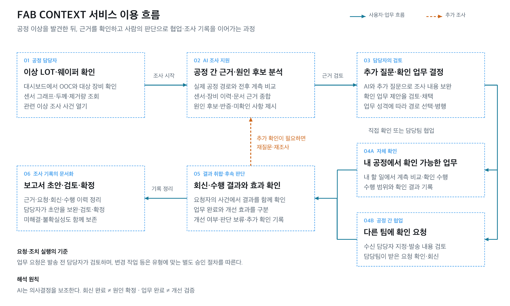
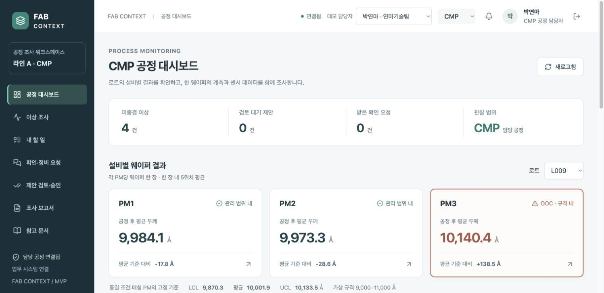
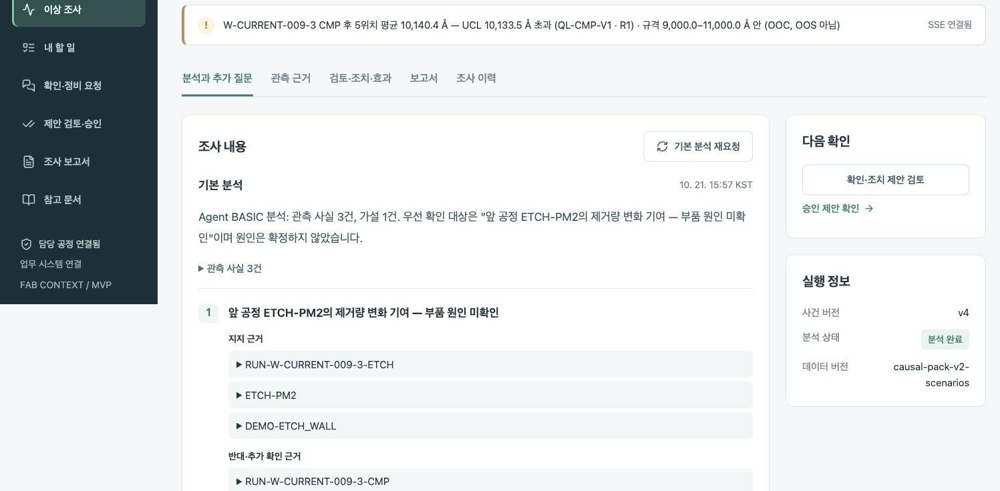
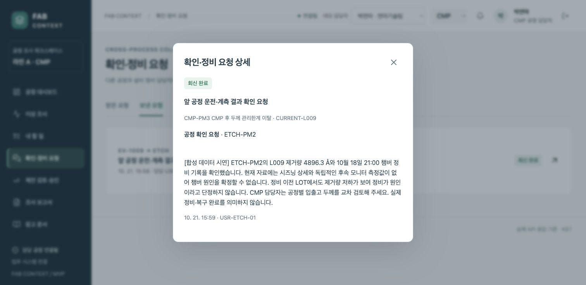
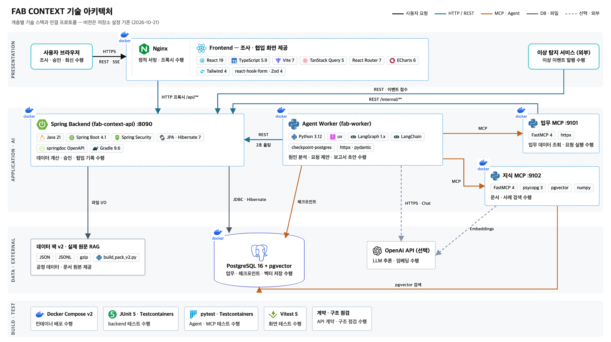
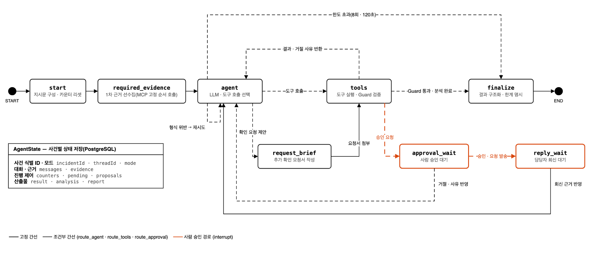
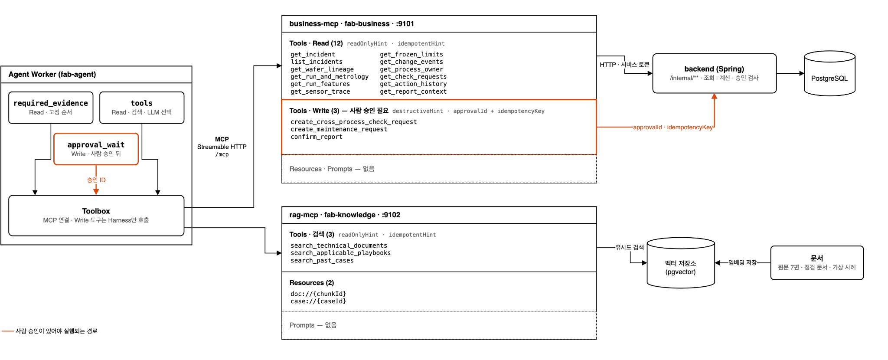

# FAB CONTEXT — 반도체 공정 이상 조사·협업 AI 서비스

공정 이상이 발생했을 때 **무엇을 먼저 확인하고, 어떤 근거로 조사하며, 누구에게 확인을 요청할지**를 지원하는 서비스입니다. 공정 엔지니어는 공정 데이터와 문서를 비교하여 조사를 진행하고, 관리자는 보고서의 원인 분류와 조사·조치 이력을 확인할 수 있습니다.

Phase 2에서는 **질문에 맞는 답변, 분석·업무·회신의 연결, 선택 결과 기반 추가 분석, 조사 우선순위, 보고서 확정·원인 통계**를 개선 대상으로 다룹니다.

| 제출 정보 | 내용 |
| --- | --- |
| Phase 2 개발 기간 | 2026.10.22~2026.10.26 |
| Phase 1 기준 | [`phase1-end`](https://github.com/FAB-SOP/FAB-AGENT/tree/phase1-end) · `edd218af65c86cd59a3a4390226d78c0a1ef468e` |
| 최종 제출 커밋 | 915c8b8 |

## 목차

- [1. 처음 실행하기](#1-처음-실행하기)
- [2. 실행 방식과 데이터 준비](#2-실행-방식과-데이터-준비)
- [3. 로그인과 화면 구성](#3-로그인과-화면-구성)
- [4. 공정 엔지니어 사용하기](#4-공정-엔지니어-사용하기)
- [5. 관리자·설비정비팀 사용하기](#5-관리자설비정비팀-사용하기)
- [6. 종료·재실행·업데이트](#6-종료재실행업데이트)
- [7. 문제가 생겼을 때](#7-문제가-생겼을-때)
- [8. 개발·선택적 검증](#8-개발선택적-검증)
- [9. 데이터와 이용 한계](#9-데이터와-이용-한계)
- [10. 기술 구성](#10-기술-구성)
- [11. 평가 조건·실행 방법·결과](#11-평가-조건실행-방법결과)
- [12. 사용 도구와 재사용 범위](#12-사용-도구와-재사용-범위)
- [13. Team & Contribution](#13-team--contribution)
- [14. 알려진 한계와 제출 전 확인](#14-알려진-한계와-제출-전-확인)

## 1. 처음 실행하기

### 1-1. 준비물

기본 사용자는 **Git과 Docker Desktop만 설치**하면 됩니다. 아래의 권장 실행은 프론트·백엔드·Agent·MCP·DB를 Docker 안에서 실행하므로, 호스트에 Java·Python·Node.js를 따로 설치할 필요가 없습니다.

| 준비물 | 확인할 사항 |
| --- | --- |
| Git | `git --version`이 실행되는지 확인 |
| Docker Desktop | 앱을 실행하고 Docker 엔진이 준비될 때까지 대기 |
| Docker Compose v2 | `docker compose version` 확인. 예전 `docker-compose` 명령이 아니라 `docker compose` 사용 |
| 터미널 | macOS·Linux의 Bash 환경. Windows는 WSL2의 Bash 환경에서 아래 명령 실행 |
| 편집기·접속 확인 | 통합 실행 예시는 `nano`와 `curl` 사용. 없으면 설치하거나 사용하는 편집기로 환경설정 수행 |
| OpenAI API 키 | 실제 AI 분석·OpenAI 임베딩을 사용할 때 필요. 키 없는 시험 실행도 가능 |

```bash
git --version
docker --version
docker compose version
docker info
```

`docker info`에서 연결 오류가 나면 먼저 Docker Desktop을 실행하세요. 최초 빌드에는 이미지와 라이브러리를 내려받을 인터넷 연결이 필요합니다.

### 1-2. 빈 폴더에서 처음 실행 — 통합 명령

**Docker Desktop을 실행한 뒤**, 아직 `FAB-AGENT` 폴더가 없는 작업 디렉터리에서 아래 블록 전체를 복사해 실행합니다. 설치 이후의 다운로드 → 설정 → 빌드 → 기동 → 접속 확인을 한 블록으로 연결했습니다. **편집기가 열리면 API 키와 실행 방식을 직접 설정해야 합니다.** 원문 청크 없이도 포함된 팀 점검 문서·가상 사례로 실행할 수 있으며, 실제 기술 문헌 검색까지 재현하려면 2-2절의 별도 파일이 필요합니다.

```bash
# macOS·Linux·WSL2에서 실행합니다. 명령 앞의 $·> 같은 프롬프트는 붙이지 않습니다.
# bash 하위 셸에서 실행하므로 중간 명령이 실패하면 이후 단계를 실행하지 않습니다.
bash <<'BASH'
set -eu

# 사전 준비 확인: 하나라도 없거나 Docker가 준비되지 않았으면 여기서 중단됩니다.
git --version
docker compose version
docker info >/dev/null
command -v nano >/dev/null
command -v curl >/dev/null

# 현재 폴더 아래 FAB-AGENT를 만듭니다. 이미 있으면 clone이 중단되며 덮어쓰지 않습니다.
git clone https://github.com/FAB-SOP/FAB-AGENT.git
cd FAB-AGENT
git rev-parse HEAD  # 재현 기록에 남길 전체 커밋 SHA

# 기존 키 파일은 덮어쓰지 않습니다. 실제 키를 Git에 올리지 마세요.
if [ ! -f ops/deploy/.env ]; then
  cp ops/deploy/.env.example ops/deploy/.env
fi

# 편집기에서 다음 값을 설정합니다. nano는 Ctrl+O → Enter로 저장, Ctrl+X로 종료합니다.
# DEPLOY_LLM=openai
# DEPLOY_MODEL=gpt-4.1-mini
# DEPLOY_FALLBACK_MODEL=gpt-4o-mini
# DEPLOY_EMBEDDER=openai
# DEPLOY_EMBED_MODEL=text-embedding-3-small
# DEPLOY_OPENAI_API_KEY=본인의_실제_API_키
# DEPLOY_DEMO_PERSONA_SWITCH=true
# 키 없이 화면 흐름만 점검하려면 DEPLOY_LLM=rule, DEPLOY_EMBEDDER=hash로 설정하고 키는 비웁니다.
# stdin은 아래 스크립트가 사용하므로 편집기는 터미널 입력을 별도로 읽습니다.
nano ops/deploy/.env </dev/tty

# 프론트·Backend·Agent·업무 MCP·지식 MCP·DB를 빌드하고 기동합니다.
# 이 명령은 기존 DB 볼륨을 삭제하지 않습니다. 실제 모델은 API 비용이 발생합니다.
bash ./ops/deploy/deploy.sh up -d --build --wait
bash ./ops/deploy/deploy.sh ps

# 웹 정상 여부를 확인합니다. .env에서 포트를 바꿨다면 아래 주소도 바꾸세요.
curl --fail --silent --show-error http://127.0.0.1:8088/healthz
printf '\n브라우저 접속: http://127.0.0.1:8088/login\n'
# 초기 로그인: cmp.park / fab1234! — 로컬 시연 계정이며 운영 환경에서 사용하지 않습니다.
BASH
```

성공하면 `ps`에 서비스 상태가 표시되고 웹 상태 확인 요청이 성공합니다. **웹 상태 확인은 Agent의 실제 답변·검색 품질까지 검증하지 않습니다.** 로그인 후 2-3절의 출처 답변 점검과 4절의 시연을 진행하세요. 빌드에 실패했다면 마지막 오류를 해결한 뒤 기존 폴더에서 1-4절을 실행하며, clone부터 반복하지 않습니다.

### 이미 다운로드한 경우 — 실행 폴더 확인

```bash
# 저장소를 다운로드한 상위 폴더에서 실행합니다. 다시 clone하지 않습니다.
cd FAB-AGENT

# 실행 버전 확인 — 평가·재현 기록에도 남깁니다.
git rev-parse HEAD
```

**이후 별도로 안내하지 않은 명령은 모두 `README.md`가 있는 프로젝트 최상위 폴더에서 실행합니다.** 1-3~1-4절은 통합 명령의 설정·기동 단계를 개별적으로 다시 수행할 때의 안내이며, 통합 실행에 성공했다면 반복할 필요가 없습니다.

### 1-3. 환경설정 파일 만들기

```bash
# 기존 설정 파일이 있으면 덮어쓰지 않습니다.
if [ ! -f ops/deploy/.env ]; then
  cp ops/deploy/.env.example ops/deploy/.env
fi
```

편집기로 `ops/deploy/.env`를 여세요. 터미널에서 편집하려면 다음 명령을 사용할 수 있습니다.

```bash
# 프로젝트 최상위 폴더에서 실행합니다. 저장 후 아래 설정 예시와 대조하세요.
nano ops/deploy/.env
```

실제 OpenAI 분석과 임베딩을 사용할 경우 아래와 같이 설정합니다.

```dotenv
# ops/deploy/.env에 입력할 설정입니다. 터미널 명령이 아닙니다.
DEPLOY_WEB_PORT=8088
DEPLOY_LLM=openai
DEPLOY_MODEL=gpt-4.1-mini
DEPLOY_FALLBACK_MODEL=gpt-4o-mini
DEPLOY_EMBEDDER=openai
DEPLOY_EMBED_MODEL=text-embedding-3-small
DEPLOY_OPENAI_API_KEY=YOUR_OPENAI_API_KEY
DEPLOY_DEMO_PERSONA_SWITCH=true
```

- `YOUR_OPENAI_API_KEY`를 본인의 유효한 API 키로 바꾸세요. 예시 문자열 그대로는 실행되지 않습니다.
- API 키는 채팅·스크린샷·Git 커밋에 포함하지 마세요. `.env`는 Git 추적에서 제외되어 있습니다.
- 위 설정은 분석과 문서·검색 질의 임베딩에 실제 API를 사용하므로 비용이 발생합니다.
- `DEPLOY_DEMO_PERSONA_SWITCH=true`는 로컬 시연용 계정 전환 설정입니다. 공용·운영 환경에서는 활성화하지 마세요.
- Nano에서는 `Ctrl+O` → Enter로 저장하고 `Ctrl+X`로 종료합니다.

키가 없다면 시험 실행용으로 다음 값만 사용하세요. 나머지 설정은 유지합니다. 이는 실제 AI 판단 품질을 평가하는 방식이 아닙니다.

복사한 `.env.example`의 기본값도 이 키 없는 점검 모드입니다. 실제 AI 실행을 원하면 위의 OpenAI 설정으로 명시적으로 변경해야 합니다.

```dotenv
# ops/deploy/.env에서 수정합니다. 실제 LLM 품질 평가에는 사용하지 않습니다.
DEPLOY_LLM=rule
DEPLOY_EMBEDDER=hash
DEPLOY_OPENAI_API_KEY=
DEPLOY_DEMO_PERSONA_SWITCH=true
```

### 1-4. 전체 서비스 실행

```bash
# 프로젝트 최상위 폴더에서 실행합니다. 설정 준비 후 전체 서비스를 기동합니다.
bash ./ops/deploy/deploy.sh up -d --build --wait

# 서비스 상태를 확인합니다. Agent에는 별도 healthcheck가 없습니다.
bash ./ops/deploy/deploy.sh ps

# 기본 포트의 웹 상태를 확인합니다. 포트를 바꿨다면 주소도 바꾸세요.
curl --fail --silent --show-error http://127.0.0.1:8088/healthz
```

첫 실행은 이미지 다운로드·빌드·DB 초기 데이터 적재·분석 준비로 시간이 걸릴 수 있습니다.

| 서비스 | 역할 | 정상 상태 확인 |
| --- | --- | --- |
| `postgres` | 업무 DB·Agent 상태·RAG 벡터 저장 | 실행 중, healthcheck 통과 |
| `backend` | 로그인·공정·사건·업무·보고서 API | 실행 중, healthcheck 통과 |
| `business-mcp` | 업무 데이터 조회·요청 실행 연결 | 실행 중, healthcheck 통과 |
| `rag-mcp` | 문서·점검 자료·가상 사례 검색 | 실행 중, healthcheck 통과 |
| `agent` | 분석·질문·보고서 작업 처리 | 실행 중. 별도 healthcheck는 없음 |
| `web` | 사용자 화면과 API 프록시 | 실행 중, healthcheck 통과 |

브라우저에서 **[http://127.0.0.1:8088](http://127.0.0.1:8088)** 에 접속하세요. 처음에는 로그인 화면이 나타납니다.

이 배포 구성에서는 웹 포트만 호스트에 공개합니다. 백엔드·MCP·DB에 접근하려고 별도 호스트 포트를 추측할 필요는 없습니다.

## 2. 실행 방식과 데이터 준비

### 2-1. 분석 모델과 검색 임베딩은 별도 설정입니다

| 실행 방식 | `DEPLOY_LLM` | `DEPLOY_EMBEDDER` | 용도 |
| --- | --- | --- | --- |
| 실제 분석·의미 검색 | `openai` | `openai` | OpenAI 분석 모델과 임베딩 API 사용 |
| 실제 분석·시험용 검색 | `openai` | `hash` | 분석은 실제 OpenAI, 검색은 글자 n-gram 해시 사용 |
| 키 없는 시험 실행 | `rule` | `hash` | 화면·도구·협업 흐름의 배선 점검. 실제 LLM 품질 평가 아님 |

`DEPLOY_MODEL`은 분석·답변 모델, `DEPLOY_EMBED_MODEL`은 검색용 임베딩 모델입니다. `DEPLOY_EMBEDDER=hash`이면 OpenAI 임베딩 모델명이 설정되어 있어도 해당 모델을 호출하지 않습니다. `openai` 임베딩이 인증·권한 오류로 실패하면 해시로 자동 전환하지 않습니다.

실제 RAG 실행 상태는 다음 명령으로 확인할 수 있습니다. API 키는 출력하지 않습니다.

```bash
./ops/deploy/deploy.sh exec -T rag-mcp python -c \
  'import json,urllib.request; print(json.dumps(json.load(urllib.request.urlopen("http://127.0.0.1:9102/healthz")),ensure_ascii=False,indent=2))'
```

`index.embedModel`, `index.dim`, `index.corpora`를 확인하세요. `TECH`는 실제 기술 문서, `PLAYBOOK`은 팀 점검 문서, `CASE`는 가상 과거 사례입니다.

### 2-2. 공개 저장소와 별도 준비 자료

공정 시연 데이터와 팀 점검 문서·가상 사례는 저장소에 포함되어 있습니다. **실제 기술 문서 발췌 파일은 별도 준비 자료**이며 Git clone만으로 내려받아지지 않습니다.

| 자료 | 위치 | 없을 때의 영향 |
| --- | --- | --- |
| 배포용 API 키 | `ops/deploy/.env`의 `DEPLOY_OPENAI_API_KEY` | 실제 OpenAI 모드는 동작하지 않음. `rule`·`hash` 시험 모드는 사용 가능 |
| 실제 기술 문서 발췌 100조각 | `data/fab-rag-real-documents-v1/rag/source-chunks.jsonl` | 실제 기술 문서 검색은 비어 있음. 포함된 팀 점검 문서·가상 사례는 검색 가능 |
| 실제 원문 PDF·선별본 | `data/fab-rag-real-documents-v1/originals/`, `selected/` | 원문 파일을 직접 열람할 수 없음. 검색 입력은 별도 청크 파일 |
| 평가자 전용 정답 파일 | `ai/evaluation/ground_truth.json`, `data/fab-causal-pack-v1/evaluation/` 등 | 정답표 기반 평가에 제한. 일반 서비스 이용에는 불필요 |

원문 발췌 파일은 이용 권한이 있는 팀 내부 자료를 받아 **최초 실행 전에** 위 경로에 두세요. 임베딩 모드만 바꾼다고 없는 문서가 자동 생성되지는 않습니다. 평가 정답을 RAG에 넣지 마세요.

**추가 파일 확보 방법:** 공개 다운로드 위치·자동 생성 절차는 제공되지 않습니다. 실행 전에 팀의 자료 제공 담당자에게 `source-chunks.jsonl`과 이용 가능 범위를 확인하여 받아야 합니다. 제공 위치·담당 연락 경로는 제출 전 확정이 필요합니다. [`data/build_pack_v2.py`](data/build_pack_v2.py)는 기존 합성 데이터 묶음의 조립 코드이며 실제 문헌 청크를 생성하는 수집기가 아닙니다.

파일을 나중에 추가했다면 분석 작업이 없는 시점에 다음과 같이 RAG를 다시 적재할 수 있습니다. DB 전체를 삭제할 필요는 없습니다.

```bash
# 프로젝트 최상위 폴더에서 실행합니다. RAG 정상 기동에 실패하면 Agent를 재시작하지 않습니다.
(
  set -e
  bash ./ops/deploy/deploy.sh stop agent
  bash ./ops/deploy/deploy.sh up -d --no-deps --no-build --force-recreate --wait rag-mcp
  bash ./ops/deploy/deploy.sh up -d --no-deps --no-build agent
)
```

RAG가 정상 기동하지 못했다면 로그와 위 상태 조회로 문제를 해결한 후 Agent를 다시 실행하세요. 문서 추가와 모델 변경은 재임베딩 및 API 비용을 발생시킬 수 있습니다.

### 2-3. 출처가 붙은 답변 확인

다음은 문서 검색과 답변의 연결을 확인하기 위한 수동 점검 절차입니다. **작성자 외 팀원의 실행 검증 완료를 의미하지 않습니다.**

1. `cmp.park`로 로그인하여 **이상 조사 → EV-1009 → 분석과 추가 질문**을 엽니다.
2. 다음 질문을 보내고 답변을 기다립니다.

```text
앞 공정 영향을 확인하려면 무엇을 점검해야 해?
점검 문서 근거와 함께 설명하고, 현재 관측 사실과 추가 확인이 필요한 내용을 구분해줘.
```

3. 답변과 연결된 근거 표시에서 문서·조각 ID 또는 자료명을 확인합니다. 화면에 제공되는 근거 상세와 **참고 문서**에서 내용을 대조합니다.
4. 다음 조건을 하나씩 기록합니다. 화면에 출처가 나타나지 않으면 통과로 간주하지 않습니다.

| 점검 항목 | 통과 조건 |
| --- | --- |
| 질문에 대한 답변 | 점검해야 할 내용과 그 이유가 질문에 맞게 설명됨 |
| 출처 추적 | 답변에 사용한 점검 문서·사례 등의 출처를 식별할 수 있음 |
| 근거 일치 | 실제 근거 내용이 답변의 주장을 뒷받침함. ID 존재만으로 통과 처리하지 않음 |
| 자료 구분 | 합성 점검 문서·가상 사례를 실제 기술 문헌과 구분함 |
| 불확실성 | 부족한 정보가 있으면 원인을 단정하지 않고 추가 확인 사항을 제시함 |

실제 기술 문헌을 근거로 한 답변은 원문 청크를 준비한 환경에서 별도로 확인합니다. 시험용 규칙 모델의 흐름 통과와 실제 LLM의 답변 품질은 별도 결과로 기록합니다.

### 2-4. 작성자 외 팀원의 새 환경 재현 확인

기존 작업 폴더를 사용하지 않는 확인자는 새 폴더에 clone하고 1절의 설정·데이터 준비를 진행합니다.

```bash
# 별도 검증 폴더가 없는 상위 디렉터리의 새 터미널에서 실행합니다.
git clone https://github.com/FAB-SOP/FAB-AGENT.git fab-context-check
cd fab-context-check
git rev-parse HEAD

# 복제본에도 배포 설정이 필요합니다. 키와 모델 설정 방법은 1-3절을 따릅니다.
if [ ! -f ops/deploy/.env ]; then
  cp ops/deploy/.env.example ops/deploy/.env
fi
nano ops/deploy/.env
```

**새 폴더에 clone했다고 DB도 새로 만들어지는 것은 아닙니다.** 기본 Compose 프로젝트명이 같으면 기존 `fab-deploy` DB를 재사용할 수 있습니다. 기존 서비스를 보존한 채 초기 환경을 확인하려면 새 터미널의 이 폴더에서 다음처럼 별도 프로젝트·빈 포트를 지정한 후 실행합니다.

```bash
# 아래 이름·포트가 이미 사용 중이면 다른 값으로 바꾸세요.
export DEPLOY_PROJECT_NAME=fab-repro-check
export DEPLOY_WEB_PORT=8098
./ops/deploy/deploy.sh up -d --build --wait
./ops/deploy/deploy.sh ps
```

이 예제의 접속 주소는 `http://127.0.0.1:8098`입니다. 같은 터미널에서 종료 명령을 실행하면 별도 프로젝트에만 적용됩니다. 기본 서비스 관리 시에는 새 터미널을 사용하거나 위 두 변수를 해제하세요. 평가 재현은 최종 제출·평가 커밋과 동일한 코드를 사용해야 합니다.

| 재현 기록 | 결과 |
| --- | --- |
| 확인자·확인 일시 | 확인 필요 — 작성자 외 팀원이 기록 |
| OS·Docker Compose 버전 | 확인 필요 — `docker compose version` 포함 |
| 실행 커밋 | 확인 필요 — `git rev-parse HEAD`의 전체 SHA |
| 실제 모델·대체 모델·임베더 | 확인 필요 — 설정과 실제 API 모델 기록을 구분 |
| 데이터 버전·원문 청크 유무 | 확인 필요 — RAG 상태의 자료별 건수 포함 |
| 새 폴더·별도 DB 실행 결과 | 미확인 — 성공/실패 및 오류 원인 기록 |
| 출처가 붙은 답변 확인 | 미확인 — 사용한 질문·답변·실제로 확인한 출처 기록 |
| 실행 로그·스크린샷 | 확인 필요 — 제출 가능한 증거 링크 |
| 발견한 문제·README 보완 | 확인 필요 — 없더라도 확인자 판단을 기록 |

## 3. 로그인과 화면 구성

### 3-1. 시연 계정

초기 생성되는 계정의 비밀번호는 모두 **`fab1234!`** 입니다. 먼저 `cmp.park`로 로그인하는 것을 권장합니다.

| 아이디 | 이름·역할 | 주요 사용 목적 |
| --- | --- | --- |
| `cmp.park` | 박연마 · CMP 공정 엔지니어 | L006·L007·L009 조사, 질문, 업무·보고서 작성 |
| `etch.lee` | 이식각 · Etch 공정 엔지니어 | 이전 Etch 공정 확인 요청 검토와 회신 |
| `cvd.kim` | 김증착 · CVD 공정 엔지니어 | CVD 사건 조사와 공정 간 협업 |
| `mnt.jung` | 정정비 · 설비정비팀 | 정비 요청 검토·회신, 원인 통계 조회 |
| `manager.choi` | 최관리 · 전체 관리자 | 관리자 승인 업무 검토, 원인 통계·보고서 이력 조회 |

상단의 **데모 담당자** 드롭다운은 `DEPLOY_DEMO_PERSONA_SWITCH=true`일 때 표시됩니다. 전환하면 해당 사용자의 권한으로 대시보드에 이동합니다. 비활성화된 환경에서는 로그아웃 후 다른 계정으로 로그인하세요.

계정에 따라 보이는 메뉴·공정 범위·실행 가능한 동작이 다릅니다. 다른 공정 사건을 조회할 수 있다고 해서 질문·조치·보고서 확정까지 가능한 것은 아닙니다.

### 3-2. 주요 메뉴

| 메뉴 | 할 수 있는 일 |
| --- | --- |
| 공정 대시보드 | LOT·설비별 결과와 웨이퍼의 계측·센서 정보 확인 |
| 이상 조사 | 사건 목록·우선순위, 기본 분석·추가 질문·관측 근거·조사 이력 조회 |
| 내 할 일 | 채택한 업무와 회신할 요청 확인, 수행 결과 기록 |
| 확인·정비 요청 | 받은·보낸 요청의 내용, 수락·거절, 회신 상태 확인 |
| 제안 검토·승인 | 승인 대상 제안의 내용·근거 검토, 승인·거절 |
| 조사 보고서 | 검색·분류 필터, 초안 검토·수정·확정, Markdown 다운로드 |
| 참고 문서 | 적재된 문서와 지식 자료 확인 |
| 원인 통계 | 관리자·설비정비팀의 분류별·월별 확정 보고서 및 관련 이력 조회 |

## 4. 공정 엔지니어 사용하기

대시보드 확인 → 우선 조사 사건 선택 → 근거 비교 → 추가 질문 → 후속 업무 결정 → 수행·회신 확인 → 필요 시 추가 조사 → 보고서 작성

AI의 문장·후보·제안은 확보된 근거와 실행 이력에 따라 달라집니다. 아래 문구는 입력 예시이지 반드시 같은 답변이 나와야 하는 정답은 아닙니다.

### 4-1. 대시보드에서 이상 확인
**L009를 활용한 예시**

1. `cmp.park`로 로그인합니다.
2. **공정 대시보드**에서 LOT `L009`를 선택합니다.
3. 설비별 웨이퍼 결과와 두께 그래프를 확인합니다.
4. 관심 웨이퍼의 계측값·센서 정보를 확인합니다.

L009는 CMP 후 두께 이상을 시작점으로 이전 Etch 공정의 영향을 함께 살펴보는 사례입니다. PM은 Process Module이며, 공정마다 같은 번호의 PM을 거쳤다고 가정하지 않습니다. 실제 웨이퍼 경로를 따라가고 각 run은 해당 공정·PM·조건에 맞는 기준과 비교합니다.

### 4-2. 사건 선택과 기본 분석 확인

1. **이상 조사**에서 `EV-1009` / `L009`를 찾습니다.
2. 우선순위를 확인한 뒤 사건을 엽니다.
3. **분석과 추가 질문**에서 기본 분석의 관측 사실·원인 후보·한계를 확인합니다.
4. **관측 근거**에서 공정 경로와 수치 근거를 비교합니다.

| 우선순위 표시 | 의미 |
| --- | --- |
| 상·중·하 | 서버가 문서화된 기준과 관측 근거로 판정한 조사 우선순위 |
| 분석 중 | 평가가 진행 중인 상태. 등급이 아님 |
| 미평가 | 저장된 우선순위 평가 결과가 없는 상태. ‘하’가 아님 |
| 판정 실패 | 평가 오류 상태. ‘하’나 정상으로 해석하지 않음 |

우선순위 표시를 누르면 제공되는 사유를 확인할 수 있습니다. 이는 원인 확정이나 실제 고장 위험도의 보증이 아닙니다. 기존 DB의 과거 사건에는 평가 결과가 없을 수 있습니다.

첫 기동 후 현재 이상 사건의 기본 분석이 진행 중일 수 있습니다. 기다린 후 확인하거나, 담당 권한과 사건 상태가 허용하면 **기본 분석 재요청**을 사용할 수 있습니다. 재요청은 기존 결과 조회가 아니라 새 분석 실행입니다.

### 4-3. 추가 질문

**분석과 추가 질문**에 다음과 같이 입력하고 **질문 보내기**를 누릅니다.

```text(예시)
CMP 제거량과 센서는 정상 범위인지 확인하고, 이전 Etch 공정의 영향을 비교해줘.
관측 사실과 원인 후보를 구분하고, 추가 확인이 필요한 근거도 알려줘.
```

실제 분석 실행 중에는 중복 질문이 제한됩니다. 승인·회신 대기와 실제 분석 실행은 다른 상태입니다. 버튼이 비활성화되면 진행 상태와 본인의 담당 공정 권한을 확인하세요. 종료된 사건에는 새 조사 작업을 요청할 수 없습니다.

### 4-4. 업무 제안 검토

**확인·조치 제안 검토**를 누르거나 **검토·조치·효과** 탭으로 이동합니다. 제안의 근거·대상·확인 내용을 읽고 채택 여부를 결정하세요.

| 진행 방식 | 사용자 동작 |
| --- | --- |
| 자체 확인 | **내 확인 목록에 추가** 후 **내 할 일**에서 수행·확인 결과 기록 |
| 다른 담당자 확인 | **요청 내용 검토·발송**에서 수신 담당자와 확인 항목 검토 |
| 관리자 승인 업무 | **채택하고 관리자 승인 요청** 후 지정 관리자의 결정 대기 |
| 필요하지 않은 제안 | **채택 안 함** 선택. 사유는 선택 입력이며 기존 이력 유지 |

Agent가 직접 승인 대기 제안을 만든 경우에는 사건 화면 또는 **제안 검토·승인**에서 내용을 검토합니다. 승인이 필요한 제안은 승인 절차를 거쳐야 실행됩니다. **승인했다고 실제 점검·정비가 완료된 것은 아니므로** 요청 실행 상태와 담당자의 수행·회신 결과를 따로 확인해야 합니다.

업무 카드가 없다면 분석 내용을 검토한 뒤 **분석에서 업무 제안**으로 업무를 만들 수 있습니다. 모든 질문이 업무 제안을 생성하는 것은 아닙니다.

### 4-5. 다른 공정에서 요청 검토·회신

Etch 확인 요청이 실제 발송된 경우 다음과 같이 진행합니다.

1. Etch 공정 엔지니어가 `etch.lee`로 로그인합니다.
2. **확인·정비 요청**에서 받은 요청을 엽니다.
3. 요청 이유·관측 근거·확인 항목을 검토합니다.
4. 수락하거나 사유를 입력하여 거절합니다.
5. 수락한 업무는 **내 할 일**에서 확인하고 점검 후 결과를 회신합니다.

수락 코멘트는 선택이며 거절 사유와 결과 회신 내용은 필수입니다. **수락은 회신이나 사건 해결 완료가 아닙니다.**

설비정비팀 요청은 `mnt.jung`, 관리자 승인 업무는 지정 관리자로 전환하여 처리합니다.

### 4-6. 회신 확인과 추가 조사

1. 요청한 계정인 CMP 공정 엔지니어(`cmp.park`)로 돌아옵니다.
2. **확인·정비 요청** 또는 사건의 조사 내용에서 상태와 회신을 확인합니다.
3. 추가 분석이 필요하면 사용 가능한 회신·업무 결과를 선택합니다.
4. **선택한 결과 N건으로 추가 분석**을 요청합니다. 추가 질문도 입력할 수 있습니다.

회신 도착만으로 추가 분석이 자동 실행되지는 않습니다. 이미 사용했거나 처리 중인 결과는 재선택이 제한될 수 있습니다. 요청이 거절되면 사유를 검토하고 추가 질문이나 다른 확인 경로를 결정하세요.

### 4-7. 보고서 생성·검토·확정

1. 사건의 **보고서** 탭(이상조사 > 해당 사건 틀릭 > 보고서)에서 **초안 생성 요청**을 누릅니다.
2. 생성된 보고서를 열어 관측 사실·조사·회신·조치·미확인 사항을 검토합니다.
3. 편집이 필요하면 수정 후 **수정 내용 저장**을 누릅니다.
4. 대표 원인 분류 **Man·Machine·Material·Method·보류 중 하나**를 선택합니다.
5. Machine이면 이상 원인관련 **장비 파라미터를 하나 이상** 선택합니다.
6. **보고서 내용을 검토했습니다.**를 체크하고 **검토한 버전 확정**을 누릅니다.

보고서 확정은 사건을 종료시키므로 남은 업무를 먼저 확인하세요. 분석 진행·미결 승인·미회신 요청·미수행 업무 등이 있으면 **확정 전 정리 목록**이 표시됩니다. 결과를 기록하거나 허용된 절차로 요청 철회·업무 미수행 종결 후 다시 확정합니다.

원인 미확정이면 부족한 근거를 기록하고 ‘보류’로 분류할 수 있습니다. 확정 후 보고서는 보존되며, 별도 AI 요약은 두 번째 확정이나 원문 수정이 아닙니다. **Markdown 다운로드**로 내보낼 수 있습니다.

## 5. 이상 조사 원인을 통계로 확인하기

1. 권한이 부여된 전체 관리자(`manager.choi`), 설비정비팀(`mnt.jung`)으로 로그인합니다.
2. **원인 통계**를 엽니다. 일반 공정 엔지니어에게는 이 메뉴가 표시되지 않습니다.
3. **연도**를 선택하여 확정 보고서 현황을 확인합니다.
4. 월별 막대를 눌러 관심 월을 선택합니다. 여러 달을 선택할 수 있습니다.
5. 파이차트 조각이나 범례에서 **Machine 등 관심 분류**를 선택합니다. 통계의 분류 필터는 복수 선택할 수 있습니다.
6. 오른쪽 보고서 목록에서 보고서를 선택하여 조사·조치 이력을 확인합니다.
7. 선택 해제는 해당 항목을 다시 누르거나 **초기화**를 누릅니다.

통계는 **이상 사건 발생일 기준**으로 확정 보고서가 있는 사건을 집계합니다. 월별 막대는 선택 연도의 전체 월을 보여 주며, 선택한 월에 따라 분류별 비중과 보고서 범위가 달라집니다. 분류 선택은 목록 필터와 파이 강조에 사용됩니다.

분류 없는 과거 확정본은 별도로 표시하며 ‘보류’로 간주하지 않습니다. 분류된 보고서가 없으면 파이가 비어 있을 수 있습니다.

## 6. 종료·재실행·업데이트

### DB를 보존하며 종료하기

```bash
# 프로젝트 최상위 폴더에서 실행합니다. 기존 DB는 보존됩니다.
./ops/deploy/deploy.sh down
```

기본 종료는 DB 볼륨을 보존합니다. **`down -v`는 DB 볼륨까지 삭제할 수 있으므로 일반 종료에 사용하지 마세요.**

### 같은 버전 다시 실행하기

```bash
# 프로젝트 최상위 폴더에서 실행합니다. 기존 이미지가 있어야 합니다.
./ops/deploy/deploy.sh up -d --no-build --wait
```

첫 실행이나 이미지가 없는 환경에서는 `--no-build` 대신 `--build`를 사용하세요.

### 최신 코드로 업데이트하기

```bash
# 작업 중인 변경사항을 확인하고 먼저 보존하세요.
git status
git switch main
git pull --ff-only origin main

# 최신 소스를 빌드하고 변경된 컨테이너를 재생성합니다.
./ops/deploy/deploy.sh up -d --build --wait
```

로컬 변경 때문에 Git 명령이 중단되면 작업을 먼저 보존하세요. 강제 초기화로 해결하지 마세요. 기본 업데이트는 DB를 삭제하지 않습니다.

### `.env`만 바꾼 경우

```bash
./ops/deploy/deploy.sh up -d --no-build --wait
```

환경변수 변경에는 이미지 재빌드가 필요하지 않지만 **컨테이너 재생성은 필요**합니다. 위 명령이 변경된 구성을 적용합니다. 단순 `restart`는 새 환경변수를 반영하지 않습니다. 포트를 바꿨다면 새 주소로 접속하고, 백엔드 재시작 후에는 다시 로그인해야 할 수 있습니다.

### DB 백업과 초기화 주의

기존 DB가 있으면 최초 시드는 다시 실행되지 않습니다. 새 시드를 보려고 DB를 지우면 작성한 사건·요청·보고서도 사라집니다. **단순 업데이트나 오류 해결을 위해 초기화하지 마세요.**

DB가 실행 중일 때 다음과 같이 백업할 수 있습니다. 매번 다른 파일명을 사용하여 이전 백업을 보존하세요.

```bash
# 프로젝트 최상위 폴더에서 실행합니다. 실행마다 새 폴더를 만들어 이전 백업을 덮어쓰지 않습니다.
mkdir -p local/backups
fab_backup_dir=$(mktemp -d local/backups/db-XXXXXXXX)
./ops/deploy/deploy.sh exec -T postgres pg_dump -U fab -d fab -Fc \
  > "$fab_backup_dir/fab.dump"
# pg_dump가 오류 없이 끝났는지 확인한 뒤 백업 경로·파일 크기를 확인하세요.
ls -lh "$fab_backup_dir/fab.dump"
```

초기화가 필요하면 백업 파일을 확인하고 업무 DB·Agent 상태·RAG 지식 중 삭제할 범위를 먼저 정하세요. 이 문서의 기본 실행·업데이트 명령은 DB를 초기화하지 않습니다.

## 7. 문제가 생겼을 때

먼저 실행 상태와 관련 로그를 확인하세요. 공유할 로그에 API 키·개인정보가 포함되지 않았는지 확인합니다.

```bash
./ops/deploy/deploy.sh ps -a
./ops/deploy/deploy.sh logs --tail=100 backend agent business-mcp rag-mcp web
```

실시간 로그는 다음과 같습니다. `Ctrl+C`는 로그 보기만 끝내며 서비스를 중지하지 않습니다.

```bash
./ops/deploy/deploy.sh logs -f --tail=100 agent
```

| 증상 | 확인·해결 방법 |
| --- | --- |
| Docker 엔진 연결 오류 | Docker Desktop 실행 여부와 `docker info` 확인 |
| 스크립트 실행 권한 오류 | `bash ./ops/deploy/deploy.sh up -d --build --wait`로 실행 |
| 포트 8088 사용 불가 | 다른 서비스의 사용 여부 확인 또는 `.env`의 `DEPLOY_WEB_PORT`를 빈 포트로 변경. 다른 서비스는 임의 종료하지 않음 |
| 예전 화면이 보임 | `git log -1 --oneline` 확인 후 최신 빌드·기동, 브라우저 새로고침·재로그인. pull만 하고 기존 이미지를 실행 중인지 확인 |
| 키를 넣어도 규칙 모델로 동작 | `DEPLOY_LLM=openai`와 배포용 `ops/deploy/.env` 확인. 설정 변경 후 `up -d --no-build --wait` 실행 |
| OpenAI 401·403 | 키 유효성·모델·API 권한 확인. 키를 출력하지 말고 수정 후 컨테이너 재생성 |
| OpenAI 429·네트워크 오류 | 사용 한도·요청 제한·연결 상태 확인. 반복 클릭으로 작업을 늘리지 말고 로그 확인 |
| RAG 기동 실패·Agent 미실행 | `rag-mcp` 로그와 임베딩 모드·키 확인. RAG의 초기 임베딩 실패는 Agent 기동도 지연시킬 수 있음 |
| 실제 기술 문서 검색이 비어 있음 | `source-chunks.jsonl`과 RAG 상태의 `TECH` 건수 확인. 모델 설정만으로 누락 문서가 복구되지는 않음 |
| 분석이 계속 대기 중 | `agent`·`business-mcp`·`rag-mcp` 상태와 Agent 로그 확인. 배포 구성은 외부 Worker가 작업을 처리함 |
| 우선순위 미평가·판정 실패 | 등급이 아닌 처리 상태. 평가 사유·로그를 확인하고 ‘하’로 해석하지 않음 |
| 로그인 실패·세션 만료 | 초기 계정·비밀번호 확인 후 재로그인. 기존 DB이면 그 DB의 계정 상태 적용 |
| 사용자 전환 메뉴 없음 | `DEPLOY_DEMO_PERSONA_SWITCH=true` 확인 후 설정 재적용. 로컬 시연에서만 사용 |
| 질문·보고서 버튼 비활성화 | 담당 공정 운영 권한, 진행 중인 실제 분석, 사건 종료 여부 확인 |
| 보고서 확정 차단 | ‘확정 전 정리 목록’의 분석·승인·미회신 요청·미수행 업무 정리 |
| 관리자 통계가 비어 있음 | 확정 보고서, 사건 발생 연도·월, 분류·권한 확인. 초안은 통계 대상이 아님 |
| 빌드 중 패키지 다운로드 실패 | 네트워크·저장소 접근과 실패 패키지 로그 확인. DB 초기화로 해결되는 문제가 아님 |

## 8. 개발·선택적 검증

일반 사용자는 이 절을 실행하지 않아도 됩니다. 배포용 `fab-deploy`와 개발용 `fab-agent`는 다른 Compose 프로젝트·DB를 사용하므로 데이터가 다를 수 있습니다.

### 8-1. 프론트 없는 개발용 구성

```bash
# 프로젝트 최상위 폴더에서 실행합니다. 하위 셸 종료 후 원래 폴더로 돌아옵니다.
(
  set -e
  cd ai
  EMBEDDER=hash FAB_LLM=rule docker compose up -d --build --wait
)
```

개발용 API 문서는 `http://127.0.0.1:8090/swagger-ui.html`입니다. 실제 API를 쓰려면 개발용 `ai/.env`에 `OPENAI_API_KEY`, `FAB_LLM`, `EMBEDDER` 등 개발 Compose가 읽는 설정을 준비합니다. 배포용 `DEPLOY_*`와 혼동하지 마세요.

### 8-2. 프론트 개발 서버

호스트에 Node.js 22·npm이 필요하며 위 개발용 백엔드를 먼저 실행합니다. 새 터미널의 프로젝트 최상위 폴더에서 실행합니다.

```bash
# 개발용 Backend 기동 후, 새 터미널의 프로젝트 최상위 폴더에서 실행합니다.
# 서버가 실행 중이면 터미널을 유지합니다. 종료는 Ctrl+C입니다.
(
  set -e
  cd frontend
  npm ci
  npm run dev -- --port 8771
)
```

접속 주소는 `http://127.0.0.1:8771`입니다. Spring을 호스트에서 직접 실행하려면 JDK 21, Agent를 직접 실행하려면 Python 3.12·uv가 추가로 필요합니다. 일반 Docker 사용에는 필요하지 않습니다.

### 8-3. 전체 협업 흐름 자동 점검 — 데이터 변경 주의

> smoke는 단순 상태 조회가 아닙니다. 서비스 API로 질문·승인·회신·보고서 흐름을 진행하여 업무 데이터를 변경합니다. 별도 검증 환경이나 복구 가능한 시연 데이터에서만 실행하세요. 실제 모델 설정이면 API 비용도 발생할 수 있습니다.

배포 구성에서는 프로젝트 최상위 폴더에서 실행합니다.

```bash
./ops/deploy/deploy.sh --profile tools run --rm --build --no-deps smoke
```

개발 구성에서는 프로젝트 최상위 폴더에서 다음 블록을 실행합니다.

```bash
# 개발용 서비스를 먼저 기동한 별도 검증 환경에서만 실행합니다. 업무 데이터가 변경됩니다.
(
  set -e
  cd ai
  docker compose --profile tools run --rm --build --no-deps smoke
)
```

실패 항목과 종료 코드를 확인하세요. 이미 종료되거나 진행 상태가 바뀐 사건을 사용하는 환경에서는 최초 시드 환경과 결과가 다를 수 있습니다.

## 9. 데이터와 이용 한계

| 파일·데이터 | 성격 | 출처·용도 |
| --- | --- | --- |
| `data/fab-causal-pack-v2/data/*` | 합성 | 팀 시연용 공정·계측·센서·장비 이력 |
| `data/fab-causal-pack-v2/knowledge/rag-chunks.jsonl` | 혼합 | 공개 참고 자료의 작성 요약 9개와 합성 점검 문서 15개 |
| `data/fab-causal-pack-v2/knowledge/synthetic-cases.jsonl` | 합성 | 가상 과거 사례 7개 |
| `data/fab-causal-pack-v2/knowledge/source-registry.json` | 출처 목록 | 지식 자료의 참고 URL·요약·적용 한계 |
| `data/fab-rag-real-documents-v1/rag/source-chunks.jsonl` | 실제 원문 발췌 | 기술 문헌 7종의 발췌 100개. 별도 준비 파일 |
| `data/fab-rag-real-documents-v1/selection-manifest.json` | 출처·선별 정보 | 원문 URL·선별 페이지·해시 |
| `ai/evaluation/ground_truth.json` 등 | 평가자 전용 | 정답·기대 결과. Agent·검색 인덱스와 분리 |

현재 RAG 적재 코드는 `rag-chunks.jsonl` 중 **`origin=TEAM_SYNTHETIC`인 점검 문서만** 사용합니다. 공개 참고 요약 9개를 실제 원문 청크로 세거나 검색 적재 건수에 더하지 않습니다. 별도 원문 파일이 없으면 실제 기술 문헌 검색은 비어 있습니다.

- **공정 시연 데이터:** 공개 문헌의 공정 원리·센서 역할을 참고한 합성 경로·계측·센서·장비 이력입니다. 수치·이상 구간·기준은 실제 Fab 검증값이 아닙니다.
- **팀 작성 지식:** 점검 문서·원인 후보·가상 사례는 실제 회사의 승인 SOP나 검증된 고장·복구 사례가 아닙니다.
- **실제 기술 문서:** MIT/TI·NIST·MKS·UCSB 등의 원문 발췌를 별도 파일로 활용합니다. 출처·적용 한계를 관리하며 공개 다운로드가 재배포·상용 이용의 일괄 허가를 뜻하지는 않습니다.
- **OOC와 OOS:** 관리한계 이탈과 규격 이탈은 다릅니다. OOC를 곧바로 제품 불량이나 규격 이탈로 단정하지 마세요.
- **사실과 가설:** 관측·계산·후보·부족한 정보를 구분합니다. 과거 사례·외부 문서만으로 현재 원인을 확정하지 않습니다.
- **업무와 조치:** 제안·채택·승인·요청·수행·효과 확인은 다릅니다. 화면 승인만으로 실제 장비 복구가 수행되는 것은 아닙니다.
- **평가 데이터 분리:** 정답·생성기·평가 문항은 Agent·RAG·실행 컨테이너의 지식 입력에 넣지 않습니다.

시연의 계정·담당자·사례는 교육용 설정이며 실제 생산 데이터나 실제 작업자 개인정보로 제시하지 않습니다. 별도 반입 문서·로그·스크린샷의 개인정보·이용 권한은 제출 전에 추가 확인합니다.

출처·선별 범위·이용 조건은 [출처 목록](data/fab-causal-pack-v2/knowledge/source-registry.json), [실제 문헌 안내](data/fab-rag-real-documents-v1/README.md), [원문 선별 목록](data/fab-rag-real-documents-v1/selection-manifest.json)에서 확인할 수 있습니다.

## 10. 기술 구성

### 서비스 흐름과 화면



| 공정 대시보드 — L009 OOC 확인 | 기본 분석 — 원인 후보와 근거 | 다른 팀 요청 — 회신 확인 |
|---|---|---|
|  |  |  |

이미지는 서비스 이해를 위한 참고입니다. 실제 버튼과 표시 내용은 실행 버전·권한·사건 상태에 따라 다를 수 있습니다.

### 아키텍처



### 조사 Agent와 MCP



조사 Agent는 LangGraph `StateGraph`입니다. 모델(LLM)은 도구를 고르고 결과를 쓰며, 실행·한도·승인·기록과 답 검사는 Harness 코드가 맡습니다. 회신이 오면 사람이 추가 분석을 요청할 때 같은 분석을 이어 가고, 회신 대기 생략 설정이면 요청을 보낸 뒤 바로 정리합니다.

청록 테두리의 `agent` · `tools`는 Phase 2에서 Harness의 검사 · 교정 로직을 보강한 노드다. 검사는 LLM이 아니라, 이번에 조회한 도구 결과 · 원문 글과 답 문장을 코드로 대조한다.

| 보강한 것 | 동작 |
|---|---|
| 데이터와 다른 내용 · 근거 없는 주장 | 조회 데이터와 반대인 단정(정상화 · 규격 이탈), 인용한 원문에 없는 관계는 한 번 돌려보내고, 다시 나오면 해당 문장만 빼고 채택 |
| 조회하지 않은 대상 | 도구 결과에 없는 로트 · 웨이퍼 · run을 말하면 반려 |
| 형식 실수 | 근거 ID 위치 · 줄여 쓴 ID · 반증된 1순위는 반려하지 않고 코드가 바로잡음 |
| 판단 한도 | 마지막 호출에서는 제출 도구를 강제해 빈 응답을 줄임 |
| 요청서 누락 | 원인 질문의 답에 요청서가 없으면 Harness가 초안을 냄 — 전송은 사람 승인 뒤 |

| 구성 | 책임 |
| --- | --- |
| Frontend | 질문·답변·근거·업무·보고서 표시와 사용자 결정 입력 |
| Backend | 인증·권한, 데이터 계산, 우선순위, Job·업무·보고서·통계 저장·조회 |
| LangGraph | 조사 흐름과 승인 대기·재개 |
| Harness | 도구 한도·출력·근거 검증, 재시도·실행 추적 |
| 업무 MCP | Backend 내부 API를 통한 공정·업무 조회와 승인된 실행 연결 |
| 지식 MCP | 실제 문헌·팀 점검 문서·가상 사례 검색 |

우선순위 계산과 원인 통계 집계는 Backend 로직입니다. AI의 원인 후보 제시는 사람의 최종 검토·원인 분류와 구분합니다.



Write 도구(확인 요청·정비 요청·보고서 확정)는 모델에게 보이지 않고, 사람이 승인한 뒤 Harness만 승인 ID와 멱등 키를 붙여 호출합니다. 업무 MCP의 Read 도구에는 사건의 지난 질문·답·회신 이력을 보는 `get_incident_history`가 있습니다. 변경 작업은 서버의 권한·승인·중복 실행 검증을 거쳐 수행합니다. 구현 상세는 선택적으로 [AI·MCP 설명](ai/README.md)을 참고하세요.

### 저장소 구성

| 폴더 | 무엇 | 문서 |
|---|---|---|
| `frontend/` | React 프론트 | — |
| `backend/` | Spring 백엔드 — 공개 API · Agent 전용 내부 API · 시뮬레이터 | [README](backend/README.md) |
| `ai/` | 업무 MCP · 지식 MCP · 조사 Agent · Harness, 개발용 compose, 평가 | [README](ai/README.md) |
| `data/` | 데이터 — 조립본 `fab-causal-pack-v2/`(실행에 쓰는 것) · 원본 팩 `fab-causal-pack-v1/` · 실제 원문 RAG `fab-rag-real-documents-v1/` · 프론트 전달 묶음 `backend-handoff-v2/`(OpenAPI · 응답 예시 · 데이터 v2) · 조립 스크립트 `build_pack_v2.py` | [README](data/README.md) |
| `ops/` | 배포 · 도구 — `deploy/`(프론트까지 포함한 로컬 배포: `deploy.sh` · `compose.web.yaml` · `.env.example`) · `tools/`(공개 API 대조 `openapi_diff.py` · Java 패키지 의존 검사 `java_pkgdeps.py`) | — |
| `docs/` | 문서 — `images/`(README 그림) | — |

이 문서만으로 기본 실행과 시연을 진행할 수 있습니다. 직접 실행·내부 구현의 상세는 [백엔드 설명](backend/README.md), [AI·MCP 설명](ai/README.md), [데이터 설명](data/README.md)을 선택적으로 참고하세요.

### 주요 API와 접근 방식

| 기능 | 메서드·경로 |
| --- | --- |
| CSRF·로그인 | `GET /api/auth/csrf`, `POST /api/auth/login` |
| 사건 목록·상세 | `GET /api/incidents`, `GET /api/incidents/{incidentId}` |
| 추가 질문 | `POST /api/incidents/{incidentId}/questions` |
| 조사 통합 대화 | `GET /api/incidents/{incidentId}/conversation` |
| 사건 실시간 갱신 | `GET /api/incidents/{incidentId}/stream` — SSE |
| 보고서 생성 | `POST /api/incidents/{incidentId}/report-jobs` |
| 보고서 확정 | `POST /api/reports/{reportId}/confirmations` |
| 원인 통계·목록 | `GET /api/cause-statistics`, `GET /api/cause-statistics/reports` |

- 공개 API는 세션 인증·권한 검사를 적용합니다. 변경 요청에는 각 계약에 따라 CSRF 토큰·멱등 키·버전 값이 필요합니다.
- 질문·보고서 생성은 비동기 Job으로 처리합니다. 요청 접수 성공과 분석·보고서 생성 완료는 다릅니다.
- 내부 API는 Agent·MCP용 서비스 인증을 사용하며 일반 사용자가 브라우저에서 직접 호출하는 경로가 아닙니다.
- Swagger는 8절의 개발용 Backend를 실행한 경우 `http://127.0.0.1:8090/swagger-ui.html`에서 확인합니다. 웹 포함 배포의 8088 포트는 Swagger 경로를 프록시하지 않습니다.

상세 계약은 [통합 대화](docs/incident-conversation-api.md), [결과·근거 계약](docs/agent-result-contract-backend.md), [보고서 맥락](docs/report-context-analysis-api.md), [원인 통계](docs/cause-statistics-api.md)를 참고하세요.

### 환경 변수 전체 요약

웹 포함 배포는 `ops/deploy/.env`를 읽습니다. 아래 기본값은 `.env.example`과 배포 Compose 기준이며, 현재 개인 환경의 실제 설정값을 뜻하지 않습니다.

| 변수 | 설명 | 기본값·예시 |
| --- | --- | --- |
| `DEPLOY_WEB_PORT` | 웹 포트 | 기본 `8088` |
| `DEPLOY_LLM` | 분석 실행 방식 | 기본 `rule`, 실제 모델은 `openai` |
| `DEPLOY_MODEL` | 기본 모델 | 배포 기본 `gpt-4o-mini`, 1절 예시는 `gpt-4.1-mini` |
| `DEPLOY_FALLBACK_MODEL` | 장애·시간 초과 시 대체 모델 | 기본 `gpt-4o-mini`. 평가에서는 사용 여부 별도 기록 |
| `DEPLOY_EMBEDDER` | 검색 임베딩 방식 | 기본 `hash`, 의미 검색은 `openai` |
| `DEPLOY_EMBED_MODEL` | 임베딩 모델 | `text-embedding-3-small` |
| `DEPLOY_OPENAI_API_KEY` | OpenAI 인증 키 | 기본 빈 값. 실제 키는 문서·커밋에 기록하지 않음 |
| `DEPLOY_DEMO_PERSONA_SWITCH` | 로컬 시연 계정 전환 | 기본 `false` |
| `DEPLOY_PROJECT_NAME` | 배포 프로젝트명 | 셸에서 지정, 기본 `fab-deploy` |

AI 개발·평가용 `ai/.env`는 `FAB_LLM`, `OPENAI_API_KEY`, `FAB_MODEL`, `FAB_FALLBACK_MODEL`, `EMBEDDER`, `EMBED_MODEL`, `FAB_PACK_DIR`, `FAB_RAG_DIR`를 사용합니다. `ai/.env.example`의 기본 모델은 `gpt-4.1-mini`이며 배포 기본값과 다릅니다. 평가 결과에는 기본값이 아니라 실제 적용값과 API가 반환한 모델명을 기록합니다.

## 11. 평가 조건·실행 방법·결과

### 11-1. 결과 공개 상태와 비교 원칙

| 평가 조건 | 현재 명시할 수 있는 내용 |
| --- | --- |
| 개선 전 코드 | `phase1-end` · `edd218af65c86cd59a3a4390226d78c0a1ef468e` |
| 개선 후 코드 | 현재 문서 검토 기준 `a8b627e` |
| 비교 범위 | Agent의 답변·근거·요청 판단 비교와 신규 우선순위·통계 기능 테스트를 분리. 최종 검증 결과서에서 범위 확정 |
| 평가셋 | 기존 E01~E03·E04~E08, Q1~Q4, 검색 질의셋을 구분. **개선전 16.3/32 -> 개선후 23.7/32** |
| 기본·대체 모델 | 아래 실행 예시는 `gpt-4.1-mini`·`gpt-4o-mini`. 실제 반환 모델·대체 발생 여부는 trace에서 기록 |
| 임베더·코퍼스 | `openai`와 `hash`를 섞어 비교하지 않음. 실제 원문 청크 유무·자료별 건수·해시를 양쪽에 동일하게 고정 |
| 데이터 버전 | 현재 팩은 `causal-pack-v2.1-scenarios`. baseline 당시와 차이가 있으면 Agent 비교용 공통 데이터 또는 조건 차이를 명시 |
| 상태·질문 순서 | 초기 DB·동일 질문·동일 사전 승인/회신 조건에서 시작. 기존 서비스의 누적 이력으로 비교하지 않음 |
| 반복·집계 | 동일 질문 반복 횟수와 고유 문항 수를 구분. 성공 n/전체 N, 실패·오류·제외·미실행을 각각 기록 |
| 측정 시각·실행 환경 | 실제 실행자가 KST 시각, OS·Docker·Java·Python 버전, 전체 커밋 SHA와 명령 기록 |


### 11-2. 평가 종류와 판정 기준

| 평가 | 구현된 도구·판정 방식 | 해석 주의 |
| --- | --- | --- |
| E01~E03 첫 판단 | `real_eval.py`·`fab-eval`: 기본 분석의 nextStep, 1순위 후보에 기대 원인 ID 포함, 첫 제안 종류·대상 공정의 조건을 모두 만족하면 통과 | 후보가 정답 하나만으로 구성되는 엄격한 단일 정답 기준이 아님. 회신 후 판단은 이 점수에 포함하지 않음 |
| E04~E08 시나리오 | `scenario_eval.py`: 근거 ID 유효성, 설정값 처방·원인/해결 단정 금지와 문항별 기대 행동 검사 | 자동 검사는 일부 조건만 판정. 답변 의미·출처 지지 여부는 원문을 사람이 추가 검토 |
| Q1~Q4 재시험 | `retest_q1_q4.py`: 준비 요청·회신 후 질문별 상태 흐름, 답변·제안·근거·최신 결과를 기록 | 준비 흐름과 4개 질문을 구분. 자동 출력만으로 최종 종합 점수가 확정되지는 않음 |
| 문서 검색 | `retrieval_eval.py`: 기대 자료가 상위 3개에 있는 비율 Hit@3, 상위 10개 내 첫 기대 자료 순위의 역수 평균 MRR | TECH·PLAYBOOK·CASE 및 기본·영어 병기·held-out 질의를 분리. 원문 없는 환경의 TECH 결과로 문헌 검색 성능을 주장하지 않음 |
| 기능 회귀 | Backend·Frontend·AI 테스트, 승인·회신 smoke | 기능 연결 통과 건수를 실제 LLM 품질 평가의 문항 수에 더하지 않음 |

최종 수동 품질 판정은 문항별 기대 행동을 사전에 고정하고 다음 조건으로 기록합니다.

- **직접 답변 적합성:** 질문의 핵심에 답하며, 단순 근거 설명 질문을 불필요한 업무 실행 요구로 바꾸지 않는가?
- **근거 일치·추적:** 조회·검색된 수치·상태·문서 내용이 주장과 일치하고, 사용자가 출처를 식별할 수 있는가?
- **질문에 맞는 출력:** 설명·추가 조사·요청 제안·보고서 작성 등 질문 목적과 결과가 일치하는가?
- **안전성:** 부족한 자료를 사실처럼 만들거나 원인·복구를 단정하지 않고, 승인 없이 승인 대상 업무를 실행하지 않는가?

수동 rubric의 최종 문항별 배점·통과 조건·판정자는 검증 결과서에서 확정해야 합니다. 조건이 다른 자동 검사 점수를 하나의 정확도로 합산하지 않습니다.

### 11-3. 기능 테스트 실행

Docker 외에 호스트의 JDK 21·Node.js 22·Python 3.12·uv가 필요한 개발자·평가자용 명령입니다. 각 블록은 **새 터미널의 프로젝트 최상위 폴더**에서 시작합니다. 이번 README 수정에서는 아래 테스트를 새로 실행하지 않았습니다.

```bash
# 프로젝트 최상위 폴더에서 실행합니다. 완료 후 Backend HTML 결과를 확인합니다.
(
  set -e
  cd backend
  ./gradlew test --no-daemon
)
```

Backend 통합 테스트는 Docker의 별도 Testcontainers DB를 사용합니다. 예를 들어 `PriorityEvaluationApiTest`, `CauseStatisticsApiTest`로 신규 우선순위·통계 기능을 검증합니다. HTML 결과는 `backend/build/reports/tests/test/index.html`입니다.

```bash
# 프로젝트 최상위 폴더에서 실행합니다. 실패하면 다음 단계를 실행하지 않습니다.
(
  set -e
  cd frontend
  npm ci
  npm run build
  npm test
)
```

```bash
# 프로젝트 최상위 폴더에서 실행합니다. 실제 API 평가는 아래 11-4절과 구분합니다.
(
  set -e
  cd ai
  uv sync --frozen
  uv run pytest
)
```

공개 클론에 정답·원문 자료가 없어 제외되는 테스트가 있으면 제외 건수와 사유를 따로 기록합니다. PR 자동 검사는 [GitHub Actions CI](.github/workflows/ci.yml)에서 변경 모듈별로 실행되며, 변경이 없어 건너뛴 잡을 실행·통과한 테스트로 세지 않습니다.

### 11-4. 실제 LLM·검색 평가 실행

> 실제 API 비용이 발생합니다. 평가 스크립트는 `fab-eval-pg`라는 평가용 컨테이너를 시작할 때 제거·재생성하고, 별도 DB 포트 55433·Spring 포트 8097을 사용합니다. 이 이름·포트에 보존할 데이터나 다른 평가가 없는지 먼저 확인하세요. 기본 배포 DB `fab-deploy`를 초기화하는 명령은 아닙니다. 평가를 동시에 여러 번 실행하지 마세요.

평가용 키·데이터 경로는 `ai/.env`에 준비합니다. 배포용 `ops/deploy/.env`의 키가 자동 공유되는 것은 아닙니다.

```bash
# 프로젝트 최상위 폴더에서 실행합니다. 완료 후 원래 폴더로 돌아옵니다.
(
  set -e
  cd ai
  if [ ! -f .env ]; then
    cp .env.example .env
  fi
  uv sync --frozen
  # OPENAI_API_KEY와 FAB_PACK_DIR·FAB_RAG_DIR를 확인하고 저장합니다.
  nano .env
)
```

`OPENAI_API_KEY`를 본인 키로 설정하고 `FAB_PACK_DIR=../data/fab-causal-pack-v2`, `FAB_RAG_DIR=../data/fab-rag-real-documents-v1` 경로를 확인합니다. E01~E03 정답표와 E04~E08 문항은 2절의 평가자 전용 파일을 받아야 하며, 없으면 해당 평가는 완료할 수 없습니다.

다음 블록은 **프로젝트 최상위 폴더**에서 실행합니다. 별도 평가용 컨테이너의 제거·재생성 및 유료 API 호출을 허용하는 검증 환경에서만 사용하세요. 최종 점수에는 실제 사용한 명령·환경·trace를 연결합니다.

```bash
# 평가 준비·전용 자료 확보 후 실행합니다. 실패하면 뒤의 평가를 계속하지 않습니다.
(
set -e
cd ai
uv sync --frozen
test -f evaluation/ground_truth.json
test -f ../data/fab-causal-pack-v1/evaluation/agent-test-cases-DO-NOT-INDEX.json
# 실제 기술 문헌 검색까지 평가하기 위한 별도 자료입니다. 없으면 먼저 확보하세요.
test -f ../data/fab-rag-real-documents-v1/rag/source-chunks.jsonl

# E01~E03 첫 판단: 3회 반복. 고유 3문항과 반복 실행 수를 구분합니다.
uv run python evaluation/real_eval.py --runs 3 --llm openai --model gpt-4.1-mini --fallback gpt-4o-mini --embedder openai

# E04~E08: 자동 검사 및 사람이 검토할 결과 원문
uv run python evaluation/scenario_eval.py --model gpt-4.1-mini --fallback gpt-4o-mini

# Q1~Q4: 승인·회신 이후 질문의 재시험 기록
uv run python evaluation/retest_q1_q4.py --label phase2 --llm openai --model gpt-4.1-mini --fallback gpt-4o-mini --embedder openai

# 검색 평가: 실제 원문 유무를 먼저 확인합니다.
uv run python evaluation/retrieval_eval.py --embedder openai --details
)
```

`real_eval.py`, `scenario_eval.py`, `retest_q1_q4.py`는 별도 평가용 Spring·DB를 사용하고 결과·trace를 `ai/evaluation/runs/`에 남깁니다. Q1~Q4 결과는 해당 실행 폴더의 `summary.json`·`summary.md`에 저장됩니다. `retrieval_eval.py`는 메모리 색인으로 실행하여 표·질의별 결과를 터미널에 출력하므로 그 출력도 별도 보관해야 합니다.

실행 폴더·로그의 시각 표기는 호스트 환경에 따를 수 있습니다. 제출 기록에는 KST 기준 시작·종료 시각과 시간대를 명시하세요. 원문·문항·키가 포함될 수 있는 실행 자료는 검토 없이 공개 커밋하지 말고, 제출 가능한 요약·가림 처리 증거를 검증 결과서에 연결합니다.

### 11-5. 실패 유형과 남은 검증

| 실패 유형 | 코드에 반영된 대응 | 개선 전·후 실측 확인 |
| --- | --- | --- |
| 질문에 직접 답하지 않거나 불필요한 요청 제안 | 질문 유형·직접 답변·요청 제안 분기 | 최종 셋에서 전후 실패 건수·답변 원문 확인 필요 |
| 조회 수치·정상/이상 상태와 다른 단정 | 조회 데이터·근거 ID 검사와 재시도·정리 | 검사 통과만으로 의미적 정확성을 보장하지 않음. 잔여 오류 확인 필요 |
| 인용 문서가 뒷받침하지 않는 관계 설명 | 문서 인용 검사·제약과 결과 정리 | 실제 문서 원문 대비 수동 검토 필요 |
| 반증된 후보가 1순위로 남음 | 후보의 stance·nextStep을 고려한 정리 | 최종 실행에서 순위·추가 확인 방향 검증 필요 |
| 분석·업무·회신의 연결이 불명확 | 사건 통합 대화·맥락·선택 결과 기반 분석 계약 | UI·API 회귀 및 팀원 시연 증거 필요 |

이 표는 실패 대응의 구현 방향이지 검증 완료나 성능 향상의 증거가 아닙니다. 최종 실패·잔여 문제는 실제 평가 N건의 로그를 바탕으로 갱신합니다.

## 12. 사용 도구와 재사용 범위

| 구분 | 도구 | 사용 범위 |
| --- | --- | --- |
| Frontend | React·TypeScript·Vite·ECharts | 조사·업무·보고서·통계 UI |
| Backend | Spring Boot·Spring Security·JPA | 인증·권한·업무·Job·저장·조회 |
| AI | LangGraph·MCP·LLM | 조사 흐름·근거 조회·답변·초안 생성 |
| 저장소 | PostgreSQL·pgvector | 업무 데이터·Agent 체크포인트·문서 벡터 |
| 실행·검증 | Docker Compose·nginx·GitHub Actions | 실행 환경·프록시·CI |
| AI 코딩 도구 | Codex | 코드·계약 확인, 테스트·배포 지원, 문서 작성·수정. 팀원별 사용 범위는 최종 확인 |
| 기타 AI 코딩 도구 | 확인 필요 | 팀원별 실제 사용 도구·범위 확인 후 기록. 미사용 도구를 임의로 기재하지 않음 |

AI 도구의 생성·수정 내용은 담당자의 diff·계약 검토와 해당 변경의 테스트·빌드·시연 기록으로 검증합니다. 이 README 편집의 명령 문법 확인과 실제 모델 평가 실행은 다른 검증입니다.

**재사용 범위:** Phase 1의 RAG·MCP·LangGraph와 조사·승인·요청·회신·보고서 기반을 재사용합니다. 위 표의 프레임워크·라이브러리는 각 의존성 명세에 선언되어 있습니다. 추가 외부 코드·템플릿을 재사용했다면 출처·라이선스/이용 조건·변경 범위를 팀이 최종 확인하여 기록해야 합니다. 실제 기술 문헌은 코드 재사용과 구분하며 9절의 출처·이용 한계를 따릅니다.

## 13. Team & Contribution

아래 Phase 2 역할은 팀이 제공한 제출 초안을 기준으로 정리했습니다. 공동 작업·겸임을 포함하며, 실제 담당 파일·기여 내용과 개인별 병합 코드 PR은 제출 전 본인 확인이 필요합니다. PR의 병합자와 실제 기여자를 동일인으로 추정하지 않습니다.

| 이름 | Phase 2 주담당 역할 — 팀 제공 초안 | 주요 담당 영역 |
| --- | --- | --- |
| 전혜민 | R1 PM·PO / R6 QA·Eval 겸임 | 문제·범위 정의, 인수 검증·제출물 |
| 황의진 | R2 AI Engineer·흐름 | Agent·Harness·출력 규격·평가 |
| 권주현 | R3 AI Engineer·RAG·Data | 문서·검색·데이터·검색 평가 |
| 유아름 | R4 Backend·Tool | Backend·Job·내부 API·업무 연결 계약 |
| 정선웅 | R4 Backend·Tool 공동 담당 | 보고서·분류·확정·요약 연결 |
| 성재현 | R5 Frontend·Demo | 조사·업무·통계 화면 및 API 연결 |

### 최신 main에 기록된 기존 담당 영역

아래는 최신 main README의 기여 기록을 보존한 내용이며, 위 Phase 2 역할 구분과는 별도로 표시합니다.

| 이름 | 역할 |
|---|---|
| 전혜민 | PM · QA |
| 유아름 | 백엔드 — 업무 API |
| 권주현 | AI 백엔드 — Agent · Harness |
| 정선웅 | 백엔드 — 업무 MCP · 분석 |
| 성재현 | 백엔드 / 프론트엔드 — 업무 API |
| 황의진 | AI 백엔드 — Agent · Harness |

## 14. 알려진 한계

| 한계·미확정 항목 | 현재 확인 내용 | 다음 단계 |
| --- | --- | --- |
| 실제 Fab 환경 미검증 | 합성 공정 데이터 기반 | 실제 데이터 적용 전 품질·권한·정책 검증 |
| 원인 확정의 한계 | AI 후보는 조사 지원이며 인과 확정이 아님 | 담당자 확인·독립 측정·조치 효과 근거 확보 |
| 원문 검색 재현 제약 | 실제 문헌 발췌 100개는 공개 저장소 미포함 | 자료 제공 담당·확보 경로·이용 권한 확정 |
| 정책 적용 범위 | 우선순위는 시연 정책. 과거 사건의 자동 소급 평가를 가정할 수 없음 | 실장비 기준 검증·재평가 정책 검토 |
