# FAB CONTEXT 아키텍처 구조도

**Feature**: [spec.md](./spec.md) · **Created**: 2026-10-21 · **근거**: 저장소 현재 코드(`feat/architecture` 브랜치)

이 문서는 저장소에 이미 구현된 구조를 정리한 것이다. 사용자 관점의 시나리오와 요구사항은
[spec.md](./spec.md)에 있다.

**표기**: 실선 = 현재 구현(As-Is). 점선 테두리 · 「예정」 = 팀 결정 대기 중인 목표 구조(To-Be) — 구현 약속이 아니다.

---

## 1. 기술 아키텍처 구조도

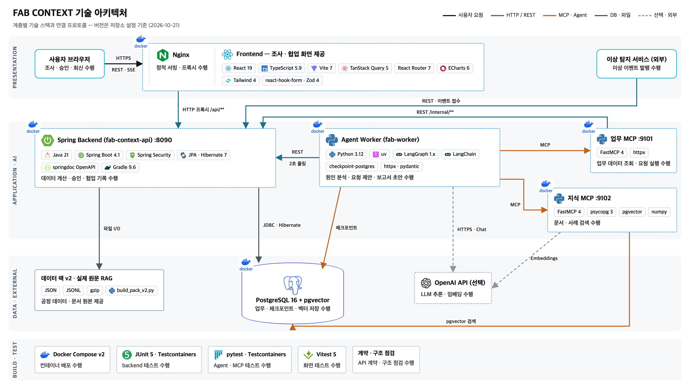

계층(프레젠테이션 · 애플리케이션/AI · 데이터/외부 · 빌드/테스트)별 기술 스택과 연결 프로토콜을 한 장에 그린 그림이다
(원본 `images/src/tech.html`, `python3 images/src/build.py`로 다시 생성). 아래 1.1–1.6은 같은 내용을 Mermaid · 표로 자세히 적은 것이다.

### 1.1 컴포넌트 · 런타임 배치

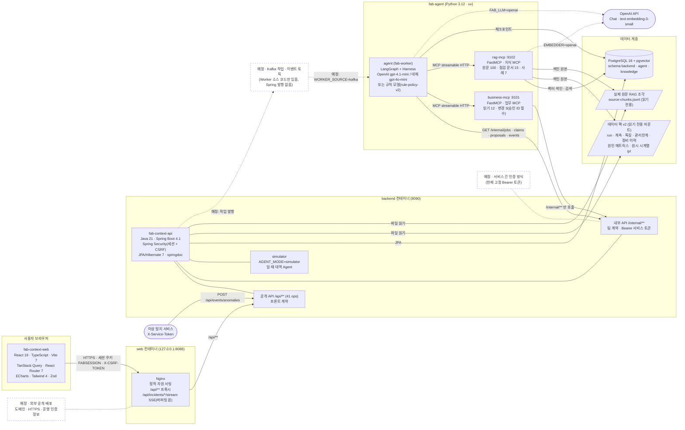

### 1.2 기술 스택 요약

| 계층 | 컴포넌트 | 기술 | 비고 |
|---|---|---|---|
| 프레젠테이션 | `fab-context-web` | React 19, TypeScript 5.9, Vite 7, TanStack Query 5, React Router 7, react-hook-form + Zod, ECharts 6, Tailwind 4, Vitest | 화면: 대시보드 · 이상 조사 · 확인/정비 요청 · 제안 승인 · 보고서 · 참고 문서 |
| 에지 | Nginx | 정적 자원 · `/api` 리버스 프록시 · SSE 무버퍼링 | 배포 구성(`compose.web.yaml`)에서만 |
| 업무 backend | `fab-context-api` | Java 21, Spring Boot 4.1, Spring Security, JPA/Hibernate 7(jsonb), springdoc OpenAPI, Gradle, Testcontainers | 유일한 backend. 공개 API · 내부 API · 승인 · 시드 · 시뮬레이터 |
| 업무 MCP | `fab.business.server` | FastMCP 4, httpx | Spring `/internal/**` 어댑터(규칙 · DB 없음) |
| 지식 MCP | `fab.rag` | FastMCP 4, pgvector, OpenAI 임베딩 / 해시 n-gram 임베딩 | 증분 색인(chunkId · contentHash), 시점 필터 |
| Agent | `fab.agent` | LangGraph 1.x, LangChain, langchain-openai, langgraph-checkpoint-postgres | Harness 8요소(지침 · 도구 · 루프 · 맥락 · 상태 · 가드 · 복구 · 관측) |
| 데이터 | PostgreSQL 16 + pgvector | 스키마 `backend` · `agent` · `knowledge` | 단일 DB, 스키마 분리 |
| 데이터 원본 | 데이터 팩 v2 · 원문 RAG | JSON · JSONL · gz | `data/build_pack_v2.py`로 결정적 조립 |
| 외부 | OpenAI | Chat Completions · Embeddings | 선택. 없으면 규칙 모델 · 해시 임베딩 |
| 실행 · 배포 | Docker Compose v2 | `fab-agent/compose.yaml` + `compose.web.yaml`(`scripts/deploy.sh`) | 웹만 외부 포트, 나머지는 내부망 |

### 1.3 Spring backend 내부 구조 (패키지 의존)

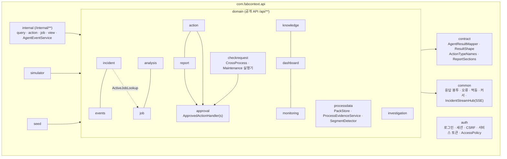

- `domain`은 `internal` · `simulator` · `seed`를 모른다. `approval`은 실행 대상을 모르고 각 도메인의 실행기가
  `approval`을 안다(의존 역전). 패키지 순환 없음(`tools/java_pkgdeps.py`).

### 1.4 Agent 그래프 (LangGraph) · Harness

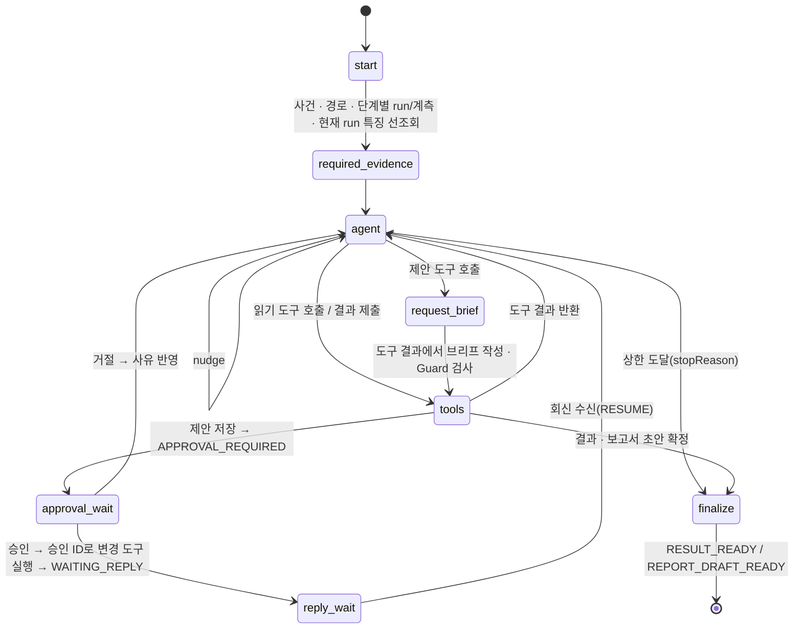

| Harness 요소 | 내용 |
|---|---|
| Instructions | 팩 지침 기반 프롬프트(BASIC · DEEP · REPORT 모드), 버전 해시를 결과에 기록 |
| Tools | 읽기 + 제안 · 제출만 노출, 변경 도구는 승인 ID로 Harness만 호출, 결과 6000자 제한 |
| Loop limits | 모델 판단 8회 · 같은 도구 3회 · 활성 120초 · LLM 30초 · MCP 10초 |
| Context | 필수 근거 선조회, 원시 시계열 대신 특징 · 요약, 6만 자 초과 시 오래된 결과 축약 |
| State | thread = 사건, Postgres `agent` 스키마 체크포인트 → Worker 재시작 후 재개 |
| Guardrails | 근거 ID · 확률 금지 · 원인 ID 15개 · nextStep 일치 · 제안 상한 2 · 반복 금지 · 브리프 숫자 검사 |
| Recovery | 일시 오류 2회 재시도 → 대체 모델 → RETRY_SCHEDULED(attempt<3) → JOB_FAILED, claim 409 → SKIPPED |
| Observability | trace_id 단위 node · tool · 지연 · 토큰, JSON 줄 파일 · LangSmith(선택) |

### 1.5 배포 토폴로지

| 구성 | 명령 | 노출 포트 | 모델 · 임베딩 기본값 |
|---|---|---|---|
| 로컬 배포(프론트 포함) | `./scripts/deploy.sh up -d --build --wait` | `127.0.0.1:8088`(web)만 | rule · hash (API 비용 없음) |
| 개발 compose | `cd fab-agent && FAB_LLM=rule docker compose up -d --build` | 8090(backend), 55432(Postgres) | rule · openai |
| Spring 단독 | `./gradlew bootRun` (+ compose postgres) | 8090 | 시뮬레이터 Agent |
| 프론트 개발 | `npm run dev -- --port 8771` | 8771 (Vite proxy → 8090) | — |
| 예정 · 외부 공개 | 미정 | 도메인 · HTTPS | 운영 인증정보 별도 설정 |

### 1.6 예정 항목 (To-Be, 팀 결정 대기)

| 항목 | 현재 상태 (As-Is) | 예정 (To-Be) | 결정 대기 사유 |
|---|---|---|---|
| 작업 전달 | Worker가 `GET /internal/jobs`를 폴링(`WORKER_SOURCE=http`) | Kafka 토픽으로 작업 · 이벤트 전달 — 소비자는 같은 `AgentEventService.handle()`로 넘긴다 | Kafka를 어디까지 쓸지 팀이 정하지 않았다. Worker 쪽 `sources/kafka.py`만 있고 Spring 발행 쪽은 없다 |
| 서비스 간 인증 | 고정 Bearer 토큰(`SERVICE_TOKEN`) · 이벤트 접수 `X-Service-Token` | 운영용 서비스 인증 방식 | 방식 잠정 보류(팀 계약 #20) |
| ID · 근거 형식 | 현재 이름(`E-RUN-*`, `E-SEG-*` 등) | 팀 확정 형식 | 다른 동료들이 확정 중 |
| 외부 배포 | 로컬 compose, 웹만 `127.0.0.1:8088` | 도메인 · HTTPS · 운영 인증정보 | 캡스톤 범위는 로컬 시연 |

---

## 2. 서비스 아키텍처 구조도

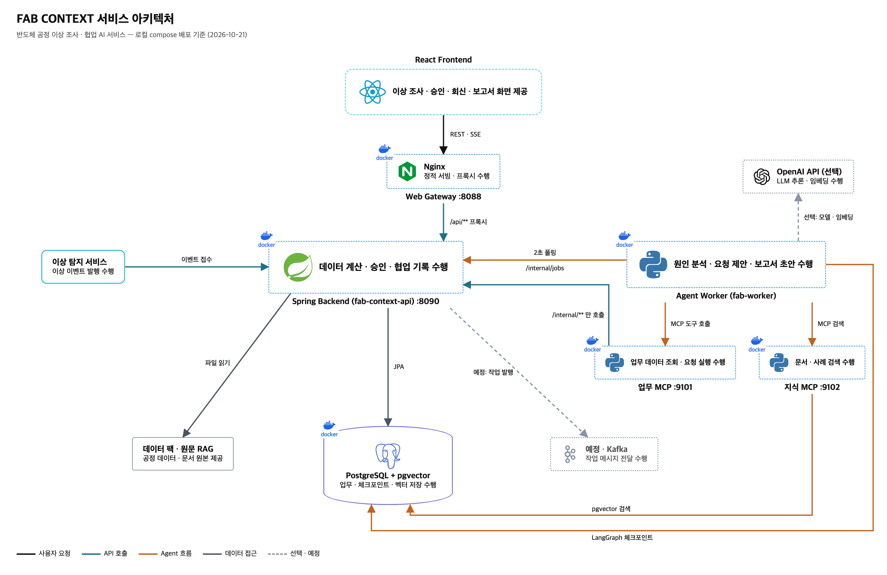

배포 단위(컨테이너) · 연결 프로토콜 · 저장소를 한 장에 그린 그림이다(원본 `images/src/service.html`, `python3 images/src/build.py`로 다시 생성).
실선 = 현재 구현, 점선 = 선택(OpenAI) · 예정(Kafka).

### 2.1 서비스 컨텍스트 — 행위자와 서비스 경계

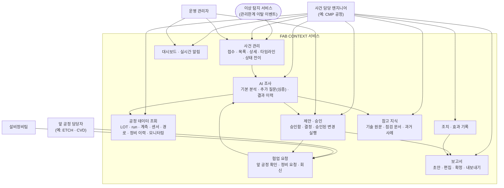

### 2.2 서비스 구성 · 책임

| 서비스 | 책임 | 주 사용자 | 공개 API 영역 | Agent 쪽 대응 |
|---|---|---|---|---|
| 사건 관리 | 이상 이벤트로 사건 생성(중복 eventId는 기존 사건), 상태 OPEN → INVESTIGATING ⇄ WAITING_REPLY → ON_HOLD/CLOSED(승인 대기는 작업 상태 WAITING_APPROVAL) | 엔지니어 · 관리자 · 탐지 서비스 | incidents · events | `get_incident` · `list_incidents` |
| 공정 데이터 | CVD → ETCH → CMP 경로의 run · 5위치 계측 · 특징 · 관리한계 · 센서 시계열 · 정비 이력. 서버 계산 증거(R1 · OOS · z · 참고 범위) | 엔지니어 | processdata · monitoring | `get_wafer_lineage` · `get_run_and_metrology` · `get_run_features` · `get_sensor_trace` · `get_frozen_limits` · `get_change_events` |
| AI 조사 | BASIC(자동) · DEEP(질문) · RESUME(승인/회신 후) · REPORT 작업, 결과를 사실 · 가설 · 한계로 저장 | 엔지니어 | investigation · analysis · job | LangGraph Worker |
| 제안 · 승인 | 제안 저장(받는 사람 검증 · 해시 · 만료), 사람 결정, 승인된 변경의 1회 실행 | 엔지니어 · 관리자 | approvals | 제안 도구 · 변경 도구(승인 ID) |
| 협업 요청 | 앞 공정 확인(CROSS_PROCESS) · 정비(MAINTENANCE) 요청과 브리프 전달, 회신 시 조사 재개 | 앞 공정 담당 · 설비정비팀 | check-requests | `create_cross_process_check_request` · `create_maintenance_request` · `get_check_requests` |
| 조치 · 효과 | 실제 수행한 검토 · 점검 · 정비 기록과 효과 확인, 분석 항목과 연결 | 엔지니어 | actions | `get_action_history` |
| 보고서 | 요청 시 초안 생성, 다섯 섹션 편집, 확정 스냅샷, Markdown 내보내기 | 엔지니어 | reports | `get_report_context` · `confirm_report` |
| 참고 지식 | 실제 원문 · 팀 점검 문서 · 가상 사례 검색 | 엔지니어 · Agent | knowledge | `search_technical_documents` · `search_applicable_playbooks` · `search_past_cases` |
| 대시보드 · 알림 | 공정별 집계, 사건별 SSE 이벤트(job · 결과 · 승인 · 요청 · 회신 · 보고서) | 전체 | dashboard · stream | — |

### 2.3 핵심 업무 흐름 — 이상 접수에서 보고서 확정까지

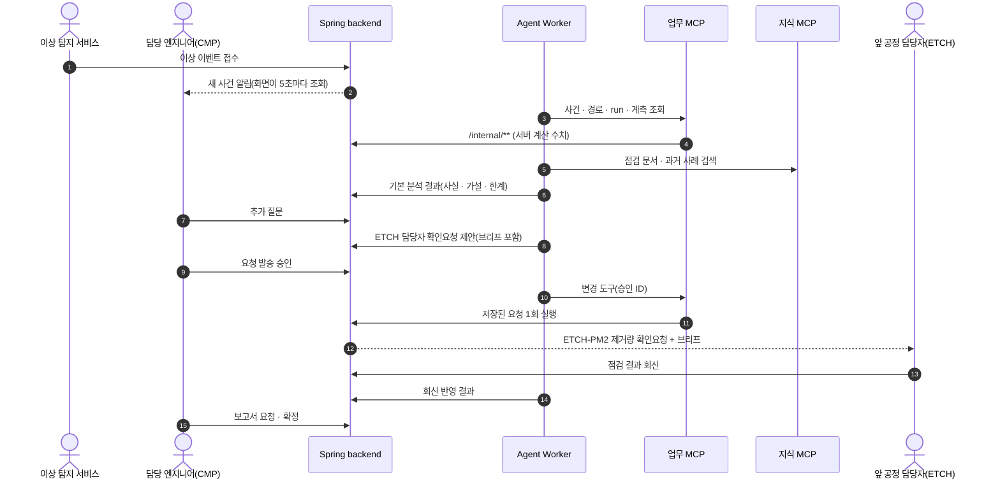

### 2.4 신뢰 경계 · 권한 모델

| 경계 | 인증 | 권한 |
|---|---|---|
| 브라우저 → 공개 API | 세션 쿠키 `FABSESSION` + CSRF 토큰, 쓰기에 `Idempotency-Key` | `processScopes`(조회) · `investigationProcessScopes`(사건 운영) · MANAGER(상태 전이) · 요청 수신자(회신) |
| 탐지 서비스 → 이벤트 접수 | `X-Service-Token` → ROLE_SERVICE | 이벤트 접수만 |
| Worker · 업무 MCP → 내부 API | `Authorization: Bearer` 서비스 토큰 → ROLE_AGENT (예정: 운영용 서비스 인증으로 교체, 1.6) | 읽기 · 작업 처리 · 제안 저장 · 승인 ID 기반 실행만 |
| Agent → 외부 모델 | `.env`의 API 키(이미지 · 로그 미포함) | 선택 사항 |
| 정답 · 저작물 | 어떤 컨테이너에도 마운트하지 않음 | 평가 스크립트만 실행 중 읽음 |

---

## 3. 유스케이스별 시퀀스 다이어그램

[spec.md](./spec.md)의 사용자 시나리오(US1–US6)마다 핵심 메시지만 그린다. 공개 API는 `/api/**`(세션 + CSRF),
내부 API는 `/internal/**`(서비스 토큰)이다. Agent Worker는 업무 MCP · 지식 MCP 도구로만 데이터를 읽고, 업무 MCP는 Spring 내부 API만 부른다.
백엔드는 Worker에게 작업을 보내지 않는다 — Worker가 2초마다 `GET /internal/jobs`로 QUEUED 작업을 가져가 확보(claim)한다(Kafka는 예정, 1.6).
이 시작 과정은 3.1에만 그리고, 3.2–3.4의 DEEP · RESUME · REPORT 작업도 같은 방식으로 시작된다. 멱등 키 같은 공통 처리는 생략했다(2.4 참고).

### 3.1 US1 — 이상 사건 자동 접수와 기본 분석

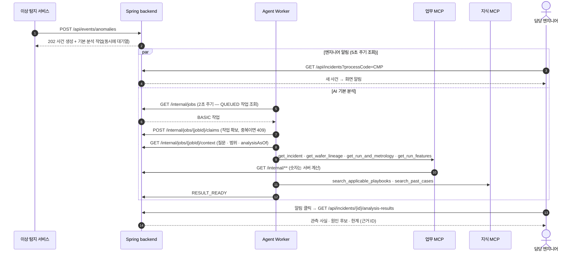

### 3.2 US2 — 추가 질문 · 제안 · 승인

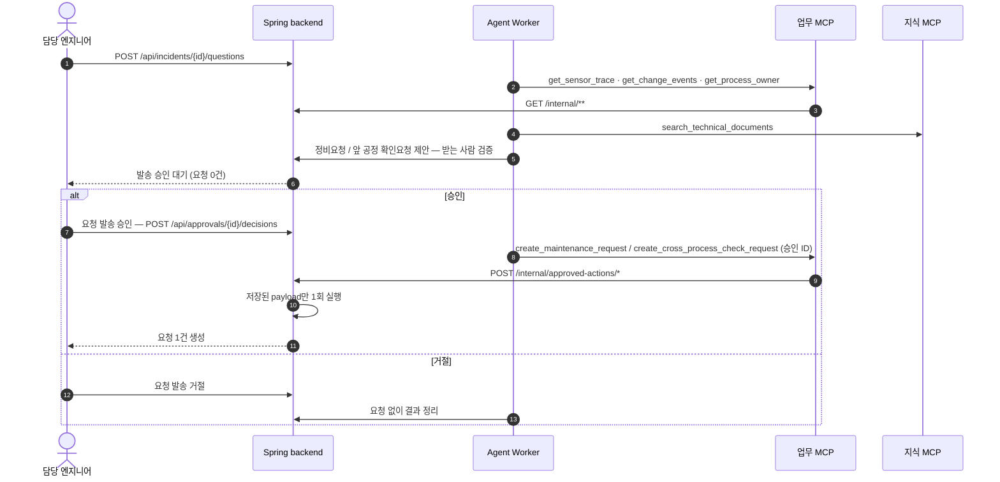

### 3.3 US3 — 다른 공정 · 설비정비팀의 요청 확인과 회신

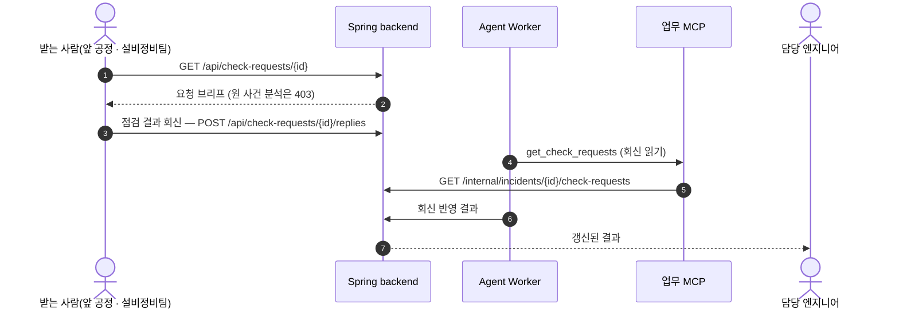

### 3.4 US4 — 조치 · 효과 기록과 보고서 확정

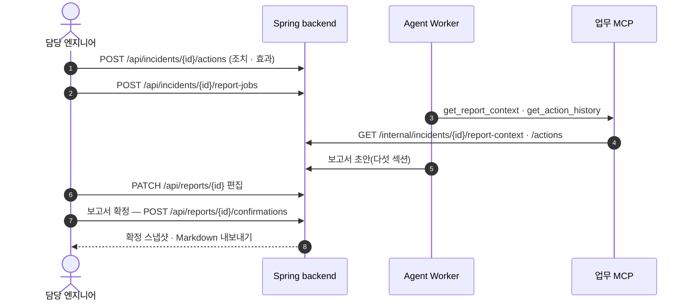

### 3.5 US5 — 공정 모니터링과 참고 지식 탐색

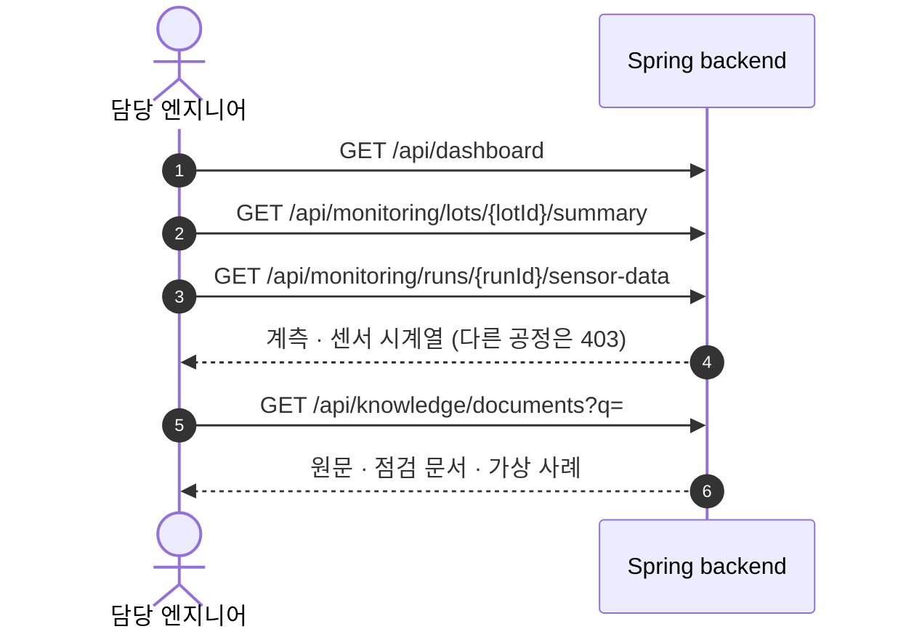

### 3.6 US6 — 관리자의 사건 상태 관리

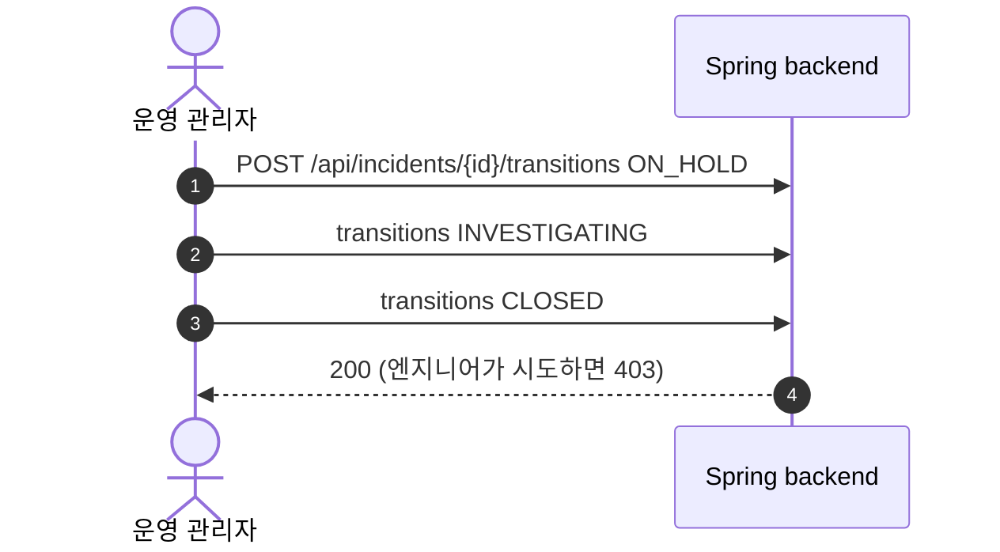
