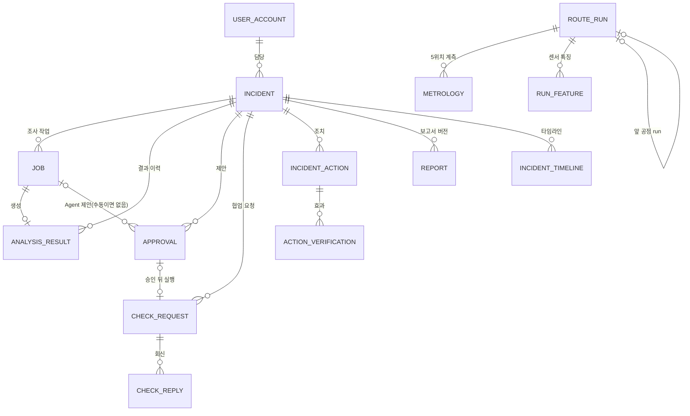
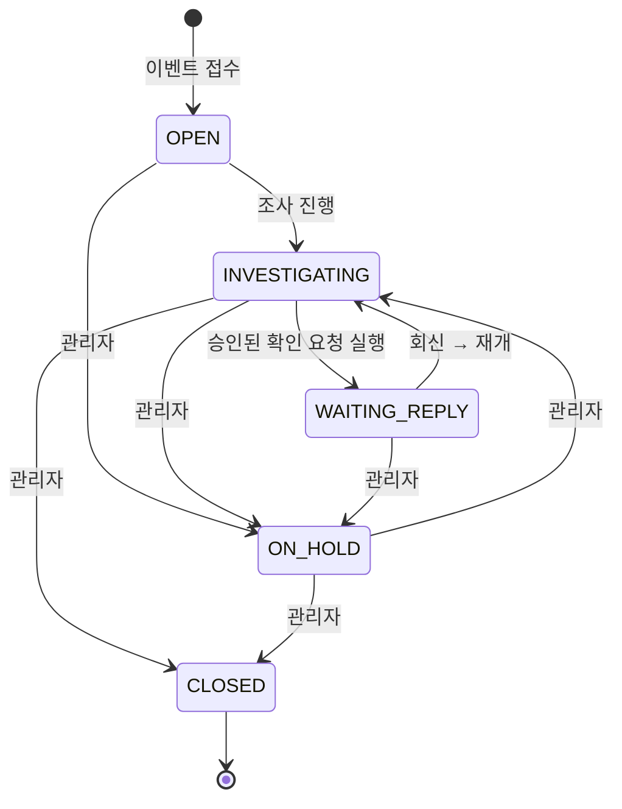
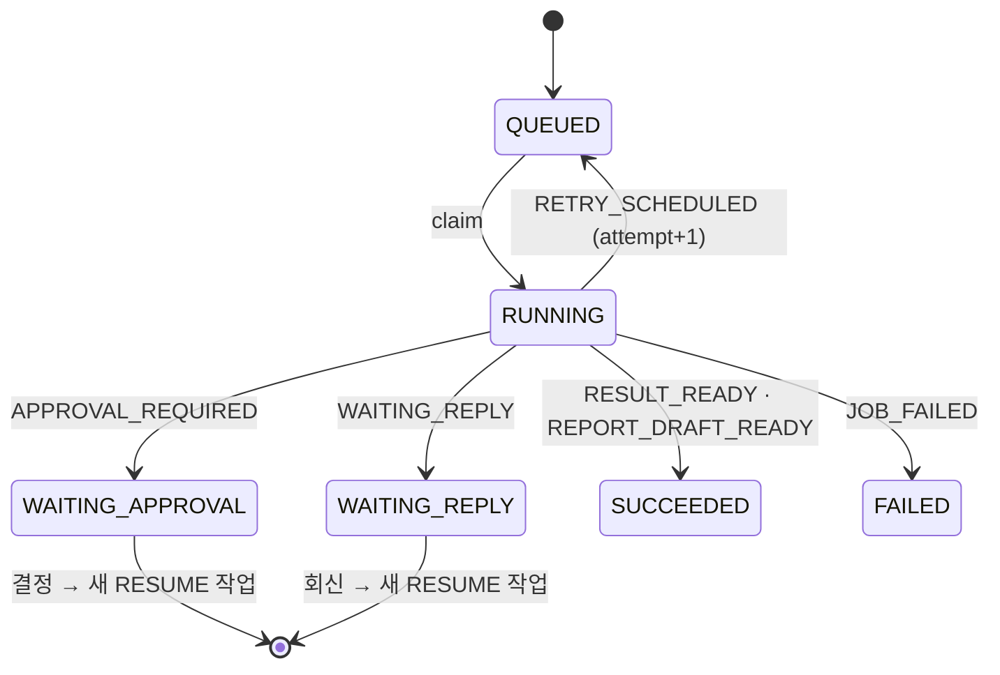

# Data Model: FAB CONTEXT 핵심 업무 데이터

**Feature**: [spec.md](./spec.md) · **Date**: 2026-10-21

이 기능은 데이터를 바꾸지 않는다. 시나리오와 구조도가 가리키는 **현재** 업무 데이터의 관계 · 상태를 정리한다.
정본은 `fab-context-api`의 엔티티(`domain/**`)와 `fab-context-api/README.md`「DB 스키마」다.

## 관계

## 엔티티 요약

이번 검증 범위(US1 · US2, plan.md)에서 직접 확인하는 엔티티: **US1** — Incident · Job · AnalysisResult,
**US2** — Approval · RequestBrief · CheckRequest(생성까지, 회신은 보류한 US3). IncidentAction · Report는 보류 시나리오용이다.

| 엔티티 | 핵심 필드 | 검증 규칙 (spec FR) |
|---|---|---|
| Incident | incidentId · displayId(EV-10NN) · processCode · waferIds · runIds · status · version | eventId 중복 → 기존 사건(FR-001), 상태 전이는 MANAGER(FR-021), `expectedIncidentVersion` 충돌 409 |
| Job | jobId · kind(BASIC · DEEP · RESUME · REPORT) · status · attempt · threadId · waiting_ref | claim은 attempt당 한 번(409 → SKIPPED) |
| AnalysisResult | observedFacts · candidateCauses · nextActions · limitations · evidenceRefs · dataVersion | 근거 ID 필수 · 확률 금지 · 원인 ID 15개 · nextStep 일치(FR-002~004) |
| Approval | approvalId · actionType · payload(brief 포함) · actionHash · expiresAt(24시간) · status · executionRef | 해시 · 만료 · 버전 재검증, 저장된 payload만 1회 실행(FR-009~013) |
| CheckRequest | requestType(CROSS_PROCESS · MAINTENANCE) · assignee · targetProcess · equipmentId · brief · causeIds · status | 받는 사람 검증(FR-011), 수신자만 열람 · 회신(FR-015) |
| RequestBrief | reason · deviations[] · suspectedCauses · relatedRecords[] · askFor[] | confirmed=true면 422, 숫자는 도구 결과에서(FR-005 · FR-010) |
| IncidentAction | actionType(REVIEW · INSPECTION · MANUAL_MAINTENANCE · OTHER) · performedAt · relatedSource | 미래 시각 422, 효과 기록이 종료를 일으키지 않음(FR-016 · 017) |
| Report | sections[5](overview · investigation · requestsAndReplies · actionsAndVerification · unresolved) · contentRevision · status · version | 다섯 키 · 순서 고정, 확정 후 새 version(FR-018 · 019) |
| UserAccount | userId · role · team · processScopes · investigationProcessScopes | 조회 · 운영 범위 분리(FR-020) |

## 상태 전이

**사건(IncidentStatus)** — 승인 대기는 사건이 아니라 작업의 상태다.

- 관리자 전이 규칙(`IncidentService`): OPEN · INVESTIGATING · WAITING_REPLY → ON_HOLD, ON_HOLD → INVESTIGATING, 그 밖의 모든
  상태 → CLOSED (그림에는 대표 간선만 그렸다).

**작업(JobStatus)** — kind: BASIC · DEEP · RESUME · REPORT

- **승인(ApprovalStatus)**: PENDING → APPROVED | REJECTED | EXPIRED, 실행되면 executionRef가 채워진다.
- **확인 요청(CheckRequestStatus)**: OPEN → REPLIED | CANCELLED.
- **보고서(ReportStatus)**: DRAFT → CONFIRMED, 확정 후 변경은 새 version의 DRAFT.
