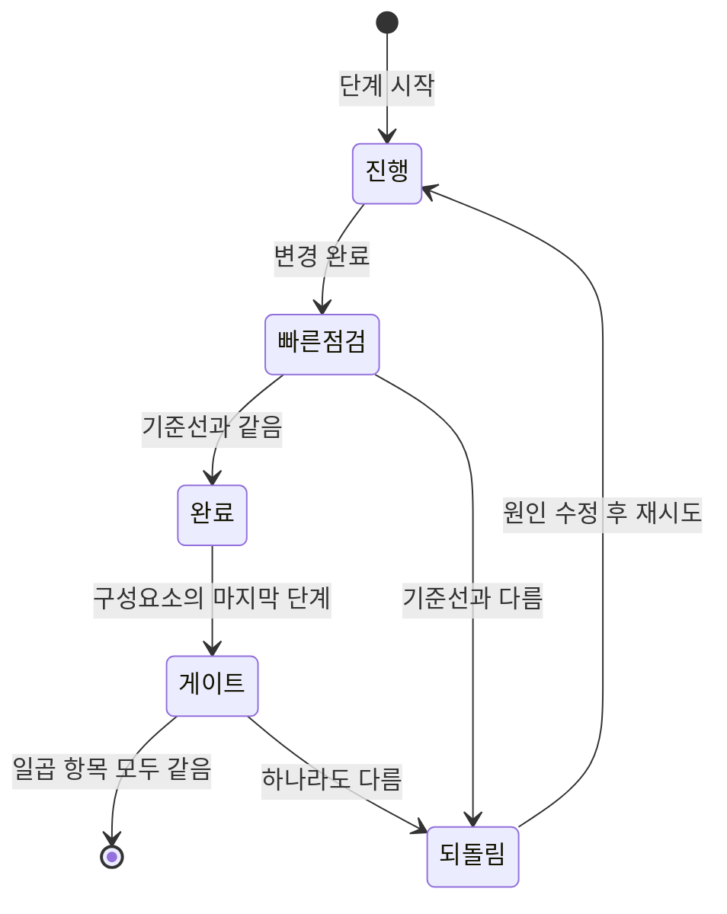

# Data Model: 리팩터링 진행 기록

**Feature**: [spec.md](./spec.md) · **Date**: 2026-10-21

런타임 데이터는 바뀌지 않는다. 이 문서는 리팩터링을 증명 · 추적하기 위해 남기는 기록의 모양이다.
모든 기록은 `specs/002-refactor-readability/records/` 아래 Markdown · 텍스트로 둔다(코드 저장소의 실행 코드와 분리).

## 엔티티

| 엔티티 | 필드 | 규칙 |
|---|---|---|
| **동작 기준선** (`records/baseline.md` + 원본 출력) | 기준 커밋 · 측정 시각 · backend 테스트(통과/건너뜀/실패) · Agent 테스트 · 화면 테스트 · 화면 빌드 · 계약 대조 표 · 스모크 check 목록 · 재시작 스모크 · DOM 스냅샷 경로 | 기준 커밋에서 한 번. 코드 변경 없이 두 번 만들어 같아야 한다(재현성, US1-독립 테스트) |
| **리팩터링 단계** (`records/steps.md`의 행) | 번호 · 구성요소 · 대상 파일 · 무엇을 · 왜 · 빠른 점검 결과 · 전체 게이트 결과(구성요소 끝) · 되돌림 여부 | 빠른 점검이 기준선과 다르면 그 단계는 되돌림 |
| **가독성 지표** (`records/metrics-before.txt` · `metrics-after.txt`) | 화면: 파일별 최대 줄 · 160자 초과 줄 수 / Python · Java: 40줄 초과 함수 목록 / Python 짧은 이름 수(파일별) | 같은 측정 스크립트로만 잰다 |
| **유지 예외** (`records/exceptions.md`) | 함수 · 줄 · 이름 · 남긴 이유 | 40줄 초과로 남기거나 바꾸지 않은 이름마다 한 줄 |
| **보류 목록** (`records/deferred.md`) | 위치 · 발견한 문제 · 영향 · 제안 | 리팩터링 중 발견한 버그 · 개선. 고치지 않는다 |

## 단계 상태

